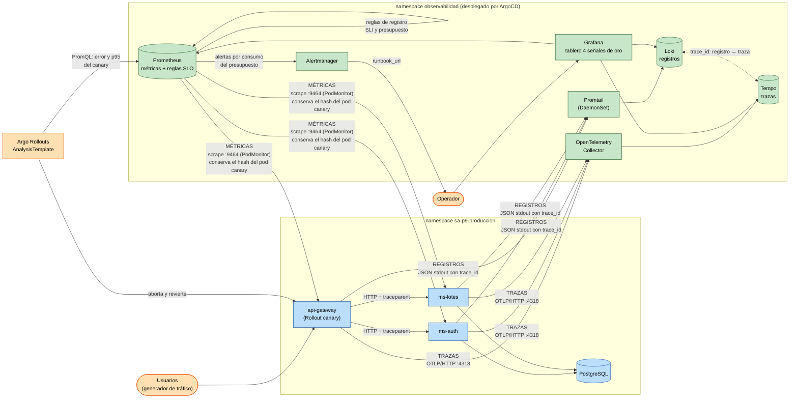

# Diagrama del flujo de telemetría

Recorrido de cada señal desde el servicio hasta el tablero, la alerta y la decisión del canary.
Versión en imagen: [diagrama-telemetria.png](diagrama-telemetria.png).

| Señal | Origen | Transporte | Almacén | Uso |
|---|---|---|---|---|
| **Trazas** | SDK OTel (auto-instrumentación http, express, pg) | OTLP → Collector | Tempo | recorrido de una petición entre servicios; span que falló |
| **Métricas** | SDK OTel, exportador Prometheus `:9464` | scrape de Prometheus (PodMonitor) | Prometheus | tablero, SLO, alertas y análisis del canary |
| **Registros** | logger pino (JSON con `trace_id`) | stdout → Promtail | Loki | detalle del error; se enlaza con la traza por `trace_id` |
