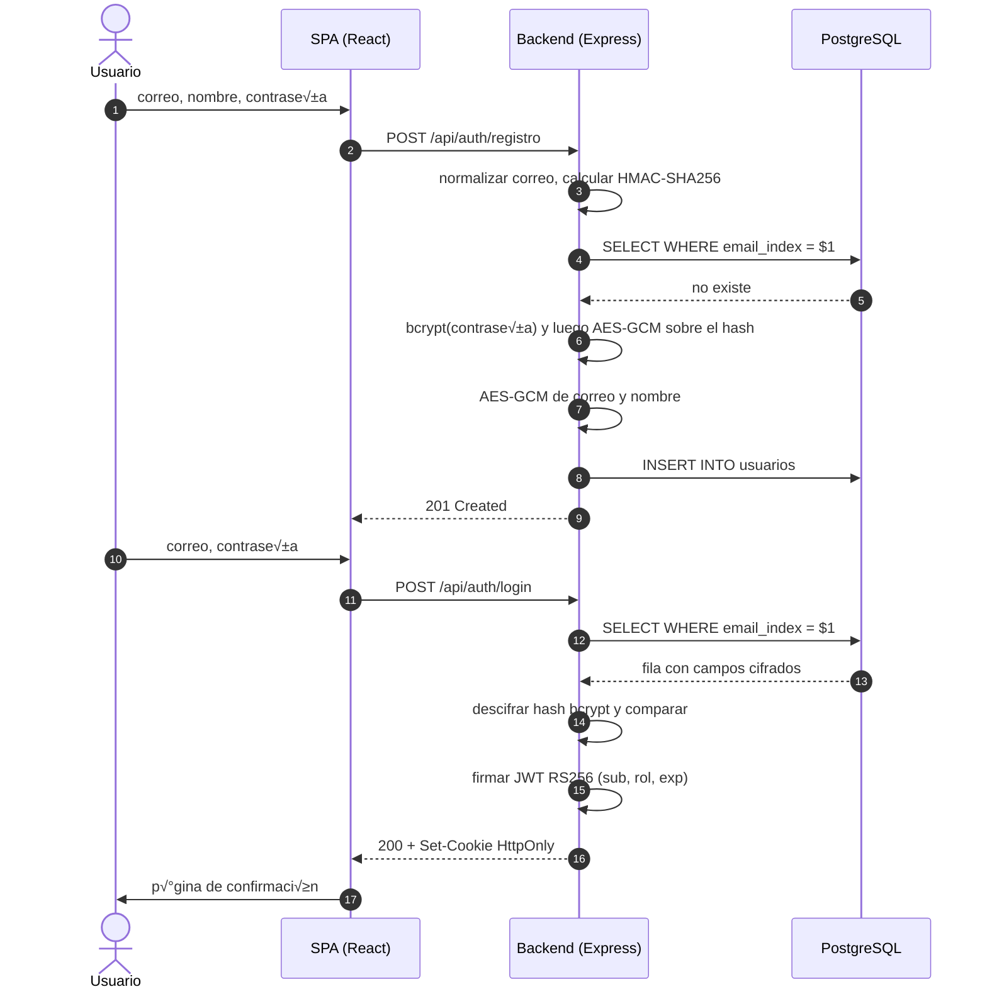
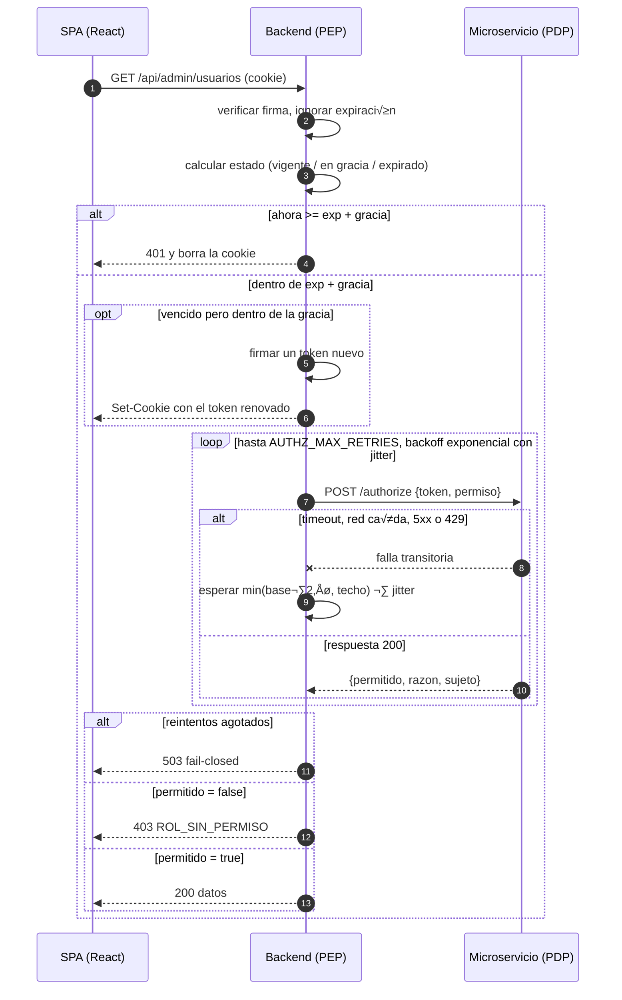

# Práctica 2 — Autenticación y Autorización

Software Avanzado · Universidad de San Carlos de Guatemala · Segundo Semestre 2026

M≥dulo de registro y login con JWT almacenado en cookies HTTP-only, cifrado AES-256-GCM de los datos sensibles, y autorizaci√≥n resuelta por un microservicio independiente al que el backend consulta mediante un ciclo de reintentos con backoff.

Este proyecto se limita deliberadamente a lo que exigen el enunciado y la rúbrica. No incluye mecanismos de seguridad adicionales (revocación de sesión, mitigación de enumeración de cuentas, rotación de llaves) que no están pedidos en ningún punto de la práctica; donde existía esa tentación, se documenta como limitación en la sección 8 en vez de implementarse sin justificación.

## Continuidad con la Pr√°ctica 1

Se conservan las tecnologías y la arquitectura de capas de la práctica anterior: Node.js con Express, PostgreSQL accedido con el driver `pg` y SQL parametrizado, configuración con `dotenv`, y la separación `rutas → controlador → servicio → repositorio` con contratos expresados como clases abstractas.

---

## 1. Arquitectura

| Componente | Puerto | Responsabilidad |
|---|---|---|
| Backend principal | 3000 | Registro, login, emisión y renovación del JWT, API REST |
| Microservicio de autorización | 3001 | Decide si un rol puede ejercer un permiso. Sin base de datos |
| PostgreSQL | — | Persistencia con campos cifrados |
| Frontend (React + Vite) | 5173 | SPA con la página de confirmación y las rutas protegidas |

El backend **aplica** las decisiones; el microservicio las **toma**.

### Por qué el microservicio está realmente desacoplado

La prueba concreta: **se puede apagar y el login sigue funcionando**. Solo dejan de resolverse las rutas protegidas.

1. **No comparte base de datos.** Su √∫nica fuente de verdad es el claim `rol` dentro del token.
2. **No comparte código.** El catálogo de permisos está duplicado a propósito en `src/permisos.js` y en `authz-service/src/politica.js`.
3. **No comparte secretos.** El JWT se firma con **RS256**: el backend firma con la clave privada, el microservicio solo tiene la pública. Es la decisión que sostiene el requisito 9 ("microservicio... desacoplado del servicio de autenticación") de forma verificable y no solo declarativa.

### Estructura

```
P2/
├── src/
│   ├── config/          env.js (validación al arrancar), database.js
│   ├── security/        AES-GCM, índice ciego, hashers, tokens, reintentos
│   ├── repositories/    UsuarioRepository (contrato) + PostgresUsuarioRepository
│   ├── services/        AuthService, SesionService
│   ├── controllers/     AuthController, RecursoController
│   ├── middlewares/     verificarSesion, requerirPermiso
│   ├── validators/      UsuarioValidator
│   ├── routes/          ensamblado de dependencias
│   ├── permisos.js      app.js      server.js      seed.js
├── authz-service/       microservicio independiente (package.json propio)
├── web/                 frontend React + Vite
├── db/schema.sql        keys/       .env.example
```

---

## 2. Ejecución

Requiere Node.js 18 o superior.

```bash
# 1. Base de datos: crear una base vacía y aplicar el esquema
psql "$DATABASE_URL" -f db/schema.sql

# 2. Claves RSA para RS256
npm run keys

# 3. Variables de entorno
cp .env.example .env
echo "AES_KEY=$(openssl rand -base64 32)"          # pegar en .env
echo "BLIND_INDEX_KEY=$(openssl rand -base64 32)"  # pegar en .env
# colocar también la cadena real en DATABASE_URL

# 4. Dependencias
npm install
cd authz-service && npm install && cp .env.example .env && cd ..
cd web && npm install && cp .env.example .env && cd ..

# 5. Usuarios de demostración
npm run seed

# 6. Levantar los tres servicios (tres terminales)
cd authz-service && npm start     # puerto 3001
npm start                          # puerto 3000
cd web && npm run dev              # puerto 5173
```

Cada servicio se arranca **desde su propia carpeta**: `dotenv` lee el `.env` del directorio de trabajo.

**Usuarios sembrados:**

| Correo | Contraseña | Rol |
|---|---|---|
| `admin@usac.edu.gt` | `Admin.12345` | admin |
| `cliente@usac.edu.gt` | `Cliente.12345` | cliente |

---

## 3. Endpoints

| Método | Ruta | Requiere | Éxito | Errores |
|---|---|---|---|---|
| `POST` | `/api/auth/registro` | — | `201` | `400` validación, `409` duplicado |
| `POST` | `/api/auth/login` | — | `200` + `Set-Cookie` | `400`, `401` |
| `POST` | `/api/auth/logout` | cookie | `204` | `401` |
| `GET` | `/api/auth/sesion` | cookie | `200` | `401` |
| `GET` | `/api/admin/usuarios` | cookie + `usuarios:listar` | `200` | `401`, `403`, `503` |
| `GET` | `/api/perfil` | cookie + `perfil:ver` | `200` | `401`, `403`, `503` |

### Matriz de acceso

| Rol | Ruta 1 — `/api/admin/usuarios` | Ruta 2 — `/api/perfil` |
|---|---|---|
| admin | Acceso permitido | Acceso permitido |
| cliente | **Acceso denegado (403)** | Acceso permitido |

La Ruta 1 lista los usuarios registrados, lo que obliga a descifrar correos y nombres: demuestra el cifrado AES funcionando en un flujo real.

### Sobre los códigos de estado

- **`401`** — no hay sesión válida (falta la cookie, firma inválida o sesión expirada).
- **`403`** — la sesión es válida pero el rol no alcanza.
- **`503`** — el microservicio no respondió tras agotar los reintentos. El acceso se deniega igual (**fail-closed**), pero no fue una decisión de política.

### Sobre `/api/auth/logout`

Limpia la cookie del navegador. **No hay revocación del lado del servidor**: el enunciado no pide un endpoint de logout ni una lista de tokens invalidados, así que no se construyó ninguna. Un token cerrado con "logout" seguiría siendo técnicamente válido hasta su vencimiento natural si alguien conservara una copia — un plazo acotado, porque el TTL máximo permitido son 3 minutos más la ventana de gracia. Ver sección 8.

---

## 4. Diagramas de secuencia

### Registro y login



### Acceso protegido, con renovación automática y reintentos



Un detalle de orden que importa: **la renovación ocurre antes de consultar al microservicio**. Por eso el microservicio puede rechazar tokens vencidos sin excepción alguna — nunca recibe uno.

---

## 5. Seguridad

### JWT en cookie HTTP-only

El token nunca aparece en el cuerpo de una respuesta ni se guarda en `localStorage`. Viaja solo en `Set-Cookie` con `HttpOnly`, `SameSite=Lax`, `Path=/` y `Secure` en producción.

El `maxAge` de la cookie cubre **TTL + gracia**. Si expirara junto con el token, el navegador la borraría y el backend nunca vería el token vencido que iba a renovar.

### Las tres ventanas de vida del token

| Zona | Condición | Comportamiento |
|---|---|---|
| Vigente | `ahora < exp` | Pasa sin tocar nada |
| En gracia | `exp ≤ ahora < exp + gracia` | Se re-emite la cookie y **la petición continúa** |
| Expirado | `ahora ‚â• exp + gracia` | `401` y se borra la cookie |

Ambos plazos son configurables: `JWT_TTL_SECONDS` (máximo 180 segundos, validado al arrancar) y `JWT_GRACE_PERIOD_SECONDS`. La decisión se toma **solo con lo que dice el propio token** — `SesionService` no consulta la base de datos, así que la petición se resuelve en memoria y es fácil de probar con un reloj inyectado.

Con tokens de tres minutos, la renovación es observable en vivo: basta iniciar sesión, esperar el vencimiento y hacer una petición para ver llegar un `Set-Cookie` nuevo sin haber vuelto a autenticarse.

### Cifrado AES-256-GCM

Formato del blob almacenado:

```
iv(12 bytes) || ciphertext || tag(16 bytes)
```

GCM es un modo autenticado: detecta manipulación del ciphertext. CBC sin MAC no lo detecta y ECB además filtra patrones. Es lo que exige el requisito 6 del enunciado.

### El índice ciego

AES-GCM usa un IV aleatorio, así que cifrar el mismo correo dos veces produce blobs distintos. Un `WHERE email_enc = $1` nunca encontraría nada y el login sería imposible.

La solución es la columna `email_index` con `HMAC-SHA256(llave, correo_normalizado)`: determinista, no reversible, con el `UNIQUE` encima. Se busca por el índice y se descifra después.

Es HMAC y no SHA-256 pelado a propósito: un hash sin llave permitiría que quien robe la base pruebe correos por diccionario y confirme quién está registrado. Esta pieza no es una adición de "buenas prácticas generales": sin ella, el requisito 6 (cifrar el correo) rompe directamente el login, que necesita poder buscar al usuario por correo.

### Contraseñas: `AES(bcrypt(password))`

El orden es deliberado. Primero bcrypt, después AES-GCM sobre el hash resultante.

Cifrar una contraseña de forma reversible es un antipatrón de seguridad grave. Con este orden la contraseña original **no es recuperable ni siquiera con la `AES_KEY`**; la capa AES protege el hash ante una fuga del dump, porque la llave vive fuera de la base.

Bcrypt trunca en silencio a 72 bytes, así que se rechaza cualquier contraseña más larga: dos contraseñas distintas no deben volverse equivalentes. La validación cuenta **bytes y no caracteres**, porque con acentos o emoji 72 caracteres pueden superar los 72 bytes.

### El ciclo de reintentos

Configurable con `AUTHZ_MAX_RETRIES`, `AUTHZ_BACKOFF_BASE_MS`, `AUTHZ_BACKOFF_MAX_MS` y `AUTHZ_TIMEOUT_MS`.

| Situación | ¿Reintenta? | Razón |
|---|---|---|
| Timeout o conexión rechazada | Sí | El servicio puede estar reiniciando |
| `429`, `500`, `502`, `503`, `504` | Sí | Falla del servidor, potencialmente pasajera |
| `200` con `permitido: false` | **No** | Es una decisión, no un fallo |
| `400`, `422` | **No** | La petición está mal formada; el error se repetiría |

**Full jitter**, no backoff exponencial puro: la espera es uniforme en `[0, min(base·2ⁿ⁻¹, techo)]`. Un backoff determinístico sincroniza a todos los procesos, que reintentan en el mismo milisegundo y vuelven a tumbar el servicio justo cuando se levantaba.

El timeout es **por intento**, no para el conjunto: sin eso un servicio lento consumiría todo el presupuesto en el primer intento.

### Otras decisiones

- El endpoint de registro **rechaza explícitamente un campo `rol`** en el cuerpo. Aceptarlo sería escalación de privilegios trivial. Los usuarios `admin` se crean con el seed.
- CORS con origen explícito y `credentials: true`. El comodín `*` es incompatible con cookies y el arranque falla si se configura.
- **La configuración se valida al arrancar.** Si `AES_KEY` y `BLIND_INDEX_KEY` son iguales, si alguna no decodifica a 32 bytes, si `JWT_TTL_SECONDS` excede 180, o si el algoritmo no es RSA, el servidor no levanta.
- Todas las consultas usan parámetros (`$1`, `$2`) para evitar inyección SQL, igual que en la Práctica 1.

---

## 6. Los cinco principios SOLID

### S — Responsabilidad única

`HttpAuthorizationClient` sabe hablar HTTP y clasificar respuestas; `RetryPolicy` sabe cu√°ndo esperar y cu√°nto. Ninguna sabe hacer lo de la otra.

```js
// src/security/RetryPolicy.js
async ejecutar(operacion, requestId) {
  for (let intento = 1; intento <= this.totalIntentos; intento += 1) {
    try {
      return await operacion(intento);
    } catch (error) {
      if (!(error instanceof ErrorTransitorio)) throw error;
      if (intento === this.totalIntentos) break;
      await this.#dormir(this.esperaMs(intento));
    }
  }
  throw new ServicioNoDisponible(...);
}
```

`RetryPolicy` **no menciona HTTP en ninguna línea**: podría reintentar cualquier operación asíncrona.

### O — Abierto/cerrado

`crearRequerirPermiso` es una f√°brica de middlewares. Agregar una tercera ruta protegida no obliga a modificarla:

```js
// src/middlewares/requerirPermiso.js
function crearRequerirPermiso(authorizationClient) {
  return (permiso) => async (req, res, next) => {
    const decision = await authorizationClient.autorizar(req.sesion.token, permiso, requestId);
    if (!decision.permitido) return res.status(403).json({ ... });
    return next();
  };
}
```

```js
// src/routes/index.js
router.get("/admin/usuarios", verificarSesion, requerirPermiso(PERMISOS.USUARIOS_LISTAR), ...);
router.get("/perfil",         verificarSesion, requerirPermiso(PERMISOS.PERFIL_VER),      ...);
```

### L — Sustitución de Liskov

`BcryptPasswordHasher` y `EncryptedPasswordHasher` extienden el mismo contrato `PasswordHasher` y son intercambiables. El segundo **envuelve** al primero sin modificarlo:

```js
// src/security/EncryptedPasswordHasher.js
class EncryptedPasswordHasher extends PasswordHasher {
  async hashear(password) {
    const hash = await this.#interno.hashear(password);
    return this.#crypto.cifrar(hash);
  }

  async verificar(password, almacenado) {
    const hash = this.#crypto.descifrar(almacenado);
    return this.#interno.verificar(password, hash);
  }
}
```

Cualquier código que reciba un `PasswordHasher` funciona con las dos implementaciones sin saber cuál le tocó.

### I — Segregación de interfaces

`UsuarioRepository` tiene cinco métodos y los cinco se usan: `existePorCorreo`, `obtenerPorCorreo`, `obtenerPorId`, `crear`, `listarTodos`. No hay un método que un consumidor reciba sin necesitarlo.

`listarTodos` elimina `passwordSecreto` antes de devolver: quien consume ese método no necesita el hash y no debe recibirlo, aunque el repositorio internamente lo maneje para otros fines.

### D — Inversión de dependencias

Ning√∫n servicio instancia sus dependencias: las recibe ya construidas. `PostgresUsuarioRepository` extiende el contrato `UsuarioRepository`, y `AuthService` depende del contrato, no de PostgreSQL:

```js
// src/services/AuthService.js
constructor(repositorio, hasher, tokenService) {
  this.#repositorio = repositorio;
  this.#hasher = hasher;
  this.#tokenService = tokenService;
}
```

El beneficio es medible: `SesionService` recibe el reloj por constructor (`reloj = () => Date.now() / 1000`), lo que permite probar las tres ventanas del token —vigente, en gracia, expirado— inyectando un reloj falso, sin esperar minutos reales y sin necesidad de una base de datos. Lo mismo con `RetryPolicy`, que recibe `dormir` y `jitter` por constructor para poder probar el backoff sin dormir de verdad.

Todas las implementaciones concretas se instancian en un √∫nico lugar: `src/routes/index.js`.

---

## 7. Tecnologías

| Tecnología | Ventajas | Desventajas |
|---|---|---|
| **Node.js 18+** | `fetch` y `AbortSignal.timeout` nativos evitan dependencias; `crypto` trae AES-256-GCM y HMAC sin instalar nada | Un solo hilo: cualquier operación bloqueante congela todas las peticiones |
| **Express 4** | Middlewares encadenables que calzan con la separación PEP/autenticación; mínimo y conocido | No impone estructura: la organización depende enteramente de la disciplina del proyecto |
| **PostgreSQL + `pg`** | `BYTEA` nativo para blobs cifrados; consultas parametrizadas; control total del SQL | Sin ORM hay que escribir el mapeo a mano; sin migraciones versionadas el esquema se aplica manualmente |
| **jsonwebtoken** | Soporte RS256 sólido; `ignoreExpiration` explícito, necesario para la ventana de gracia | Los nombres de error son cadenas y hay que compararlos por texto |
| **bcryptjs** | JavaScript puro: se instala sin compilador ni `node-gyp` | M√°s lento que el binding nativo `bcrypt`; con costo alto se nota |
| **cookie-parser** | Lectura de cookies en una línea | Una dependencia más para algo casi trivial |
| **dotenv** | Mantiene credenciales fuera del código, mismo patrón de la Práctica 1 | Lee el `.env` del directorio actual, cada servicio debe arrancarse desde su carpeta |
| **React + Vite** | Recarga instant√°nea; `credentials: 'include'` sencillo | Al correr en otro origen obliga a configurar CORS con cuidado |

### Decisiones descartadas

- **Una librería de reintentos** (p. ej. `tenacity`/`retry`). Funcionaría, pero escondería en un decorador justo la lógica que el enunciado pide implementar.
- **HS256 para el JWT.** Más simple, pero obligaría a compartir el mismo secreto entre los dos servicios y el desacoplamiento sería solo aparente.
- **Un ORM.** La Práctica 1 usó `pg` directo y se mantiene por continuidad.
- **Revocación de sesión (`token_version`), señuelo contra enumeración de cuentas, y rotación de llaves de cifrado.** Se evaluaron y se descartaron explícitamente: ninguno está pedido en el enunciado ni en la rúbrica, y cada uno habría añadido una tabla, una columna o un parámetro de configuración sin sustento en los entregables. Quedan documentados como limitaciones conscientes en la sección 8, no como trabajo pendiente.

---

## 8. Limitaciones conocidas

Se documentan en vez de ocultarse:

1. **No hay revocación de sesión.** El logout limpia la cookie del cliente, pero el token seguiría siendo técnicamente válido hasta su vencimiento natural si alguien conservara una copia. El enunciado no pide un mecanismo de revocación, y el TTL máximo de 3 minutos acota el riesgo por diseño.
2. **Sin protección contra enumeración de cuentas por temporización.** Un correo inexistente responde más rápido que una contraseña incorrecta. No está pedido en el enunciado.
3. **Sin circuit breaker.** Con el microservicio caído, cada petición paga el presupuesto completo de reintentos (~1 s con la configuración por defecto) antes del `503`.
4. **El índice ciego filtra igualdad.** Dos usuarios con el mismo correo producirían el mismo índice. Es inherente a la técnica y necesario para el `UNIQUE`.
5. **Catálogo de permisos duplicado** en los dos servicios, por diseño. Si divergen, el microservicio responde `PERMISO_DESCONOCIDO` en lugar de negar en silencio.
6. **Sin límite de tasa** en registro y login.
7. **El esquema se aplica manualmente** con `db/schema.sql`, sin migraciones versionadas.
8. **Sin rotación de llaves de cifrado.** Perder `AES_KEY` inutiliza la base. No está pedido en el enunciado y añadirlo hubiera significado versionar cada blob cifrado sin necesidad real en el alcance de esta práctica.
≠ que cada servicio debe arrancarse desde su carpeta |
| **React + Vite** | Recarga instant√°nea; `credentials: 'include'` sencillo | Al correr en otro origen obliga a configurar CORS con cuidado |

### Decisiones descartadas

- **Una librería de reintentos.** Funcionaría, pero escondería en un decorador justo la lógica que el enunciado pide implementar. Está escrita a mano para poder inspeccionarla y modificarla.
- **HS256 para el JWT.** Más simple, pero obligaría a compartir el mismo secreto entre los dos servicios y el desacoplamiento sería solo aparente.
- **Un ORM.** La Práctica 1 usó `pg` directo y se mantiene por continuidad; para una sola tabla no compensa.
- **Tabla de sesiones.** `token_version` cubre el caso real con una columna en vez de una tabla más un proceso de limpieza. Limitación aceptada: no se puede cerrar una sesión específica dejando las demás vivas.

---

## 8. Limitaciones conocidas

Se documentan en vez de ocultarse:

1. **Sin circuit breaker.** Con el microservicio caído, cada petición paga el presupuesto completo de reintentos (~1 s con la configuración por defecto) antes del `503`.
2. **El índice ciego filtra igualdad.** Inherente a la técnica y necesario para el `UNIQUE`.
3. **El microservicio no conoce `token_version`.** No puede saber si un token fue revocado por logout; esa verificación la hace el backend antes de consultarlo.
4. **Catálogo de permisos duplicado** en los dos servicios, por diseño. Si divergen, el microservicio responde `PERMISO_DESCONOCIDO` en lugar de negar en silencio, pero falta una prueba que compare ambos catálogos.
5. **Sin límite de tasa** en registro y login. El señuelo de tiempo mitiga la enumeración por temporización, no el abuso por volumen.
6. **El esquema se aplica manualmente** con `db/schema.sql`, sin migraciones versionadas.
7. **Perder `AES_KEY` inutiliza la base.** No hay mecanismo de respaldo de llaves.
