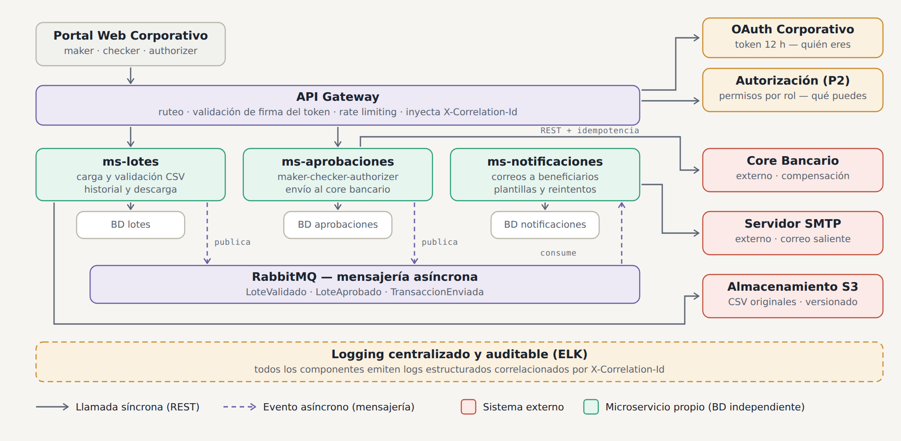
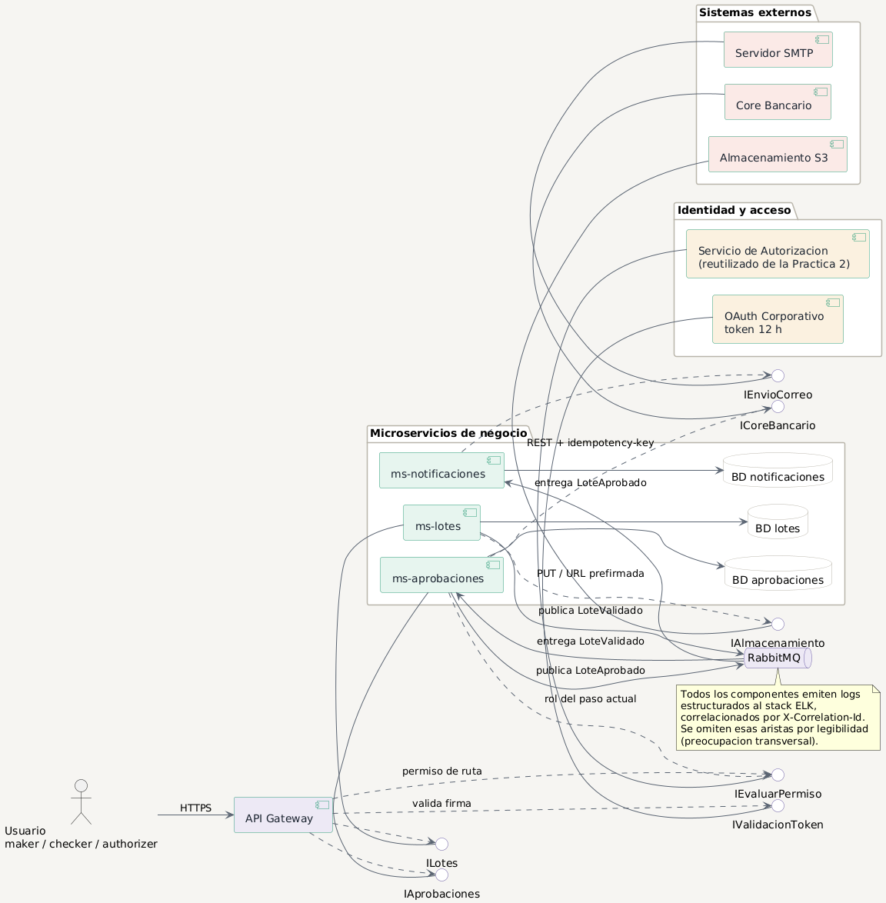
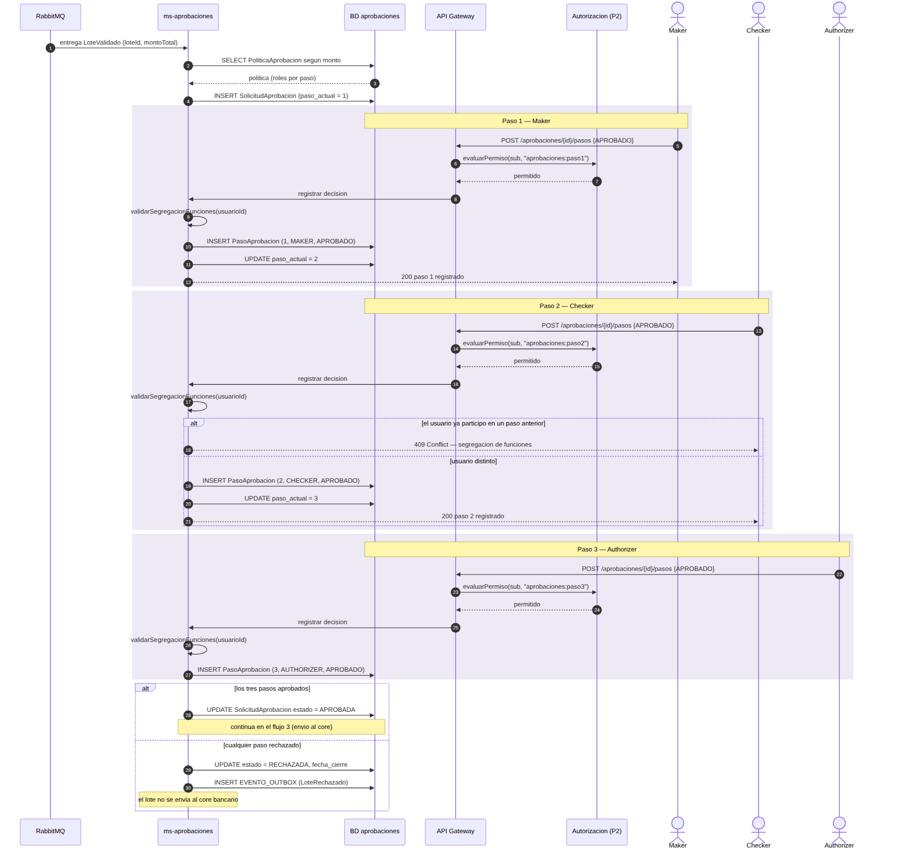

# Práctica 3 — Diseño de Arquitectura

**Sistema de procesamiento de transacciones bancarias por lotes**

Software Avanzado · Universidad de San Carlos de Guatemala · Segundo Semestre 2026

---

## 1. El problema

El sistema actual de procesamiento de transacciones es **monolítico** y se degrada en los picos de demanda: cierre de mes, planillas masivas de clientes corporativos, temporada de impuestos. Cuando la carga sube, todo el sistema se ralentiza por igual, porque no hay forma de escalar solo la parte que lo necesita.

Este documento propone el **diseño inicial** de una solución basada en microservicios que resuelve ese problema y satisface los requisitos del negocio.

### Qué gana el negocio al romper el monolito

| Problema del monolito | Cómo lo resuelve el diseño |
|---|---|
| La validación de un lote de 10,000 filas bloquea todo el sistema | `ms-lotes` se escala de forma independiente en los picos |
| Un fallo del servidor de correo tumba el procesamiento | Las notificaciones corren desacopladas por mensajería |
| Un cambio en las reglas de fraude obliga a redesplegar todo | Solo se redespliega `ms-lotes` |
| No hay trazabilidad de quién aprobó qué | Rastro de auditoría inmutable en `ms-aprobaciones` |

---

## 2. Arquitectura general



Tres microservicios de negocio, cada uno con su propia base de datos, detrás de un API Gateway. La identidad se resuelve con el OAuth corporativo y los permisos con el módulo de autenticación desarrollado en la Práctica 2. La comunicación es **REST cuando alguien espera respuesta** y **mensajería asíncrona cuando no**.

| Componente | Responsabilidad | Tipo |
|---|---|---|
| API Gateway | Punto único de entrada, valida token, rutea, aplica *rate limiting* | Propio |
| `ms-lotes` | Carga y validación de CSV, almacenamiento, historial y descarga | Propio |
| `ms-aprobaciones` | Flujo maker-checker-authorizer y envío al core bancario | Propio |
| `ms-notificaciones` | Correos a los beneficiarios del lote | Propio |
| OAuth Corporativo | Identidad, token de 12 horas | Externo |
| Servicio de Autorización | Permisos por rol — **reutilizado de la Práctica 2** | Propio |
| Core Bancario | Compensación interbancaria | Externo |
| Almacenamiento S3 | Archivos CSV originales | Externo |
| Servidor SMTP | Correo saliente | Externo |
| Stack ELK | Logging centralizado y consultable | Infraestructura |
| RabbitMQ | Mensajería asíncrona entre servicios | Infraestructura |

---

## 3. Diseño de los microservicios

### 3.1 El criterio de separación

La pregunta que define una frontera no es *"¿qué hace este servicio?"* sino **"¿por qué razón cambiaría?"**. Si dos funcionalidades cambian por motivos distintos, pertenecen a servicios distintos.

| Servicio | Cambia cuando… | Reglas del negocio que cubre |
|---|---|---|
| `ms-lotes` | Cambia el formato del CSV o una regla de validación | Carga, validación (saldo, límites, cuentas, fraude), almacenamiento, historial, descarga |
| `ms-aprobaciones` | Cambia la política de aprobación (pasos, roles, montos) | maker-checker-authorizer, envío al core bancario |
| `ms-notificaciones` | Cambia el proveedor de correo o las plantillas | Correos a beneficiarios |

**Prueba de que no hay solapamiento:** ninguna regla de negocio del enunciado se implementa en dos servicios a la vez, y ningún servicio consulta la base de datos de otro.

### 3.2 Lo que deliberadamente NO es un microservicio

- **Logging** → es infraestructura transversal (stack ELK), no un servicio de negocio. Convertirlo en microservicio agregaría un despliegue, un modelo de datos y un punto de fallo sin beneficio.
- **Autenticación** → ya existe. El OAuth es corporativo y el módulo de permisos viene de la Práctica 2. No se rediseña, se integra.

### 3.3 Modelos de datos y clases

Cada microservicio es dueño exclusivo de su base de datos.

- [Modelos ER y diagramas de clases de los tres servicios](diagramas/03-modelos-er-y-clases.md)

| Servicio | ER | Clases |
|---|---|---|
| `ms-lotes` | [ver](diagramas/03-er-ms-lotes.png) | [ver](diagramas/04-clases-ms-lotes.png) |
| `ms-aprobaciones` | [ver](diagramas/05-er-ms-aprobaciones.png) | [ver](diagramas/06-clases-ms-aprobaciones.png) |
| `ms-notificaciones` | [ver](diagramas/07-er-ms-notificaciones.png) | [ver](diagramas/08-clases-ms-notificaciones.png) |

**Una base de datos por microservicio.** Una base compartida crea acoplamiento invisible: dos servicios que leen la misma tabla ya no se despliegan ni escalan por separado, y un cambio de esquema los rompe a ambos.

**El costo que se acepta conscientemente:** se pierden los `JOIN` entre servicios y las transacciones ACID distribuidas. Por eso el `lote_id` que aparece en `ms-aprobaciones` **no es una llave foránea** sino una referencia externa: la integridad la garantiza el flujo de eventos, no el motor de base de datos.

### 3.4 Diagrama de componentes



Muestra los **contratos**: qué interfaz provee cada componente y cuál requiere. Es lo que permite afirmar que el Core Bancario puede reemplazarse por otro proveedor siempre que respete `ICoreBancario`.

---

## 4. Integración con el módulo de autenticación de la Práctica 2

El sistema combina **dos mecanismos que responden preguntas distintas**:

| | OAuth Corporativo | Módulo de la Práctica 2 |
|---|---|---|
| Responde | *¿Quién eres?* | *¿Qué puedes hacer?* |
| Vigencia | Token de 12 horas (jornada laboral) | Se consulta en cada petición |
| Emite | Identidad corporativa (SSO) | Decisión de permiso por rol |
| Se valida en | API Gateway | Gateway y cada microservicio |

### 4.1 Por qué hacen falta los dos

Si los permisos viajaran dentro del token OAuth de 12 horas y a un usuario le revocaran el rol de *authorizer* a las 9 de la mañana, **su token seguiría diciendo que es authorizer hasta las 9 de la noche**. Consultando el servicio de autorización en cada petición, la revocación surte efecto de inmediato.

En un sistema que mueve dinero y exige segregación de funciones, esa ventana de 12 horas es inaceptable.

### 4.2 Qué se reutiliza exactamente

El módulo de la Práctica 2 aporta el patrón **PEP/PDP**:

- **PEP** (*Policy Enforcement Point*) — el API Gateway y cada microservicio **aplican** la decisión
- **PDP** (*Policy Decision Point*) — el servicio de autorización **toma** la decisión

Junto con el mecanismo de **reintentos con backoff exponencial y jitter** ya implementado allí, que en esta arquitectura se reaplica para el envío al core bancario.

### 4.3 Diferencia respecto a la Práctica 2

En la Práctica 2 el token duraba 3 minutos porque **era** la credencial de autorización. Aquí el token de 12 horas solo prueba identidad; la autorización se resuelve aparte y en tiempo real. Es el mismo servicio cumpliendo un rol distinto dentro de un sistema mayor.

### 4.4 Dónde se ve en los diagramas

- [Flujo 1 — carga de CSV](diagramas/09-secuencia-carga-csv.png): bloque de autenticación y autorización antes de aceptar el archivo
- [Flujo 2 — aprobación](diagramas/10-secuencia-aprobacion-3-pasos.png): consulta de permiso en cada uno de los tres pasos

---

## 5. Flujo de aprobación de 3 pasos (maker-checker-authorizer)



### 5.1 Definición

Ningún lote llega al core bancario sin tres aprobaciones de **tres personas distintas**:

| Paso | Rol | Qué hace |
|---|---|---|
| 1 | **Maker** | Prepara y presenta el lote. Confirma que el archivo es el correcto |
| 2 | **Checker** | Revisa el contenido: montos, cuentas destino, totales |
| 3 | **Authorizer** | Autoriza la salida del dinero. Es la firma final |

### 5.2 Los dos controles de cada paso

En cada paso se ejecutan **dos validaciones distintas, en capas distintas**:

| Control | Quién lo resuelve | Pregunta |
|---|---|---|
| `evaluarPermiso` | Servicio de autorización (Práctica 2) | ¿Este usuario tiene el rol de este paso? |
| `validarSegregacionFunciones` | `ms-aprobaciones` | ¿Es una persona distinta a las anteriores? |

El primero es **autorización**. El segundo es **regla de negocio**. Están separados a propósito: si la segregación de funciones viviera en el servicio de permisos, este tendría que conocer el historial de aprobaciones de cada lote y dejaría de ser un servicio genérico.

### 5.3 Reglas del flujo

1. La **política se lee al crear la solicitud**, no en cada paso. Así un cambio de política a mitad del flujo no altera un lote en curso: lo que se aprueba es lo que se pactó al inicio.
2. Los pasos son **estrictamente secuenciales**. `paso_actual` impide saltarse el checker.
3. Un **rechazo en cualquier paso cierra la solicitud**. No se continúa al siguiente.
4. Intentar aprobar un paso habiendo participado antes devuelve **`409 Conflict`**, no `403`. El usuario sí tiene el rol; lo que falla es el estado de la solicitud.
5. Cada decisión queda registrada con usuario, fecha y comentario en `PasoAprobacion` — es el **rastro de auditoría inmutable**.

---

## 6. Estrategia de almacenamiento de archivos CSV

### 6.1 Decisión: object storage (S3), no base de datos ni disco local

| Alternativa | Por qué se descarta |
|---|---|
| Guardar el CSV como BLOB en la base de datos | Infla la base, encarece los respaldos y degrada las consultas |
| Disco local del servidor | Se pierde al reiniciar el contenedor; impide escalar horizontalmente |
| **S3 (elegida)** | Almacenamiento barato, durable, versionado y con URLs prefirmadas |

### 6.2 Diseño

```
s3://transacciones-lotes/{año}/{mes}/{loteId}/original.csv
```

- **El archivo original nunca se modifica.** Es la evidencia de lo que el cliente cargó. Si hay una disputa, ese archivo es la prueba.
- **Versionado activado** en el bucket: protege contra borrado accidental.
- **Cifrado en reposo** con SSE-KMS.
- **Hash SHA-256** calculado al cargar y guardado en la base de datos. Garantiza que el archivo que se descargue meses después es idéntico al original.
- **Bucket privado.** La descarga se hace con **URL prefirmada temporal** (por ejemplo, 5 minutos de validez), no proxeando el archivo por el microservicio. Así el servicio no gasta memoria ni ancho de banda en archivos grandes, y el bucket nunca queda expuesto.
- **Ciclo de vida:** 90 días en almacenamiento estándar, luego a Glacier para retención de largo plazo.

### 6.3 Historial consultable

`ms-lotes` expone el historial de todos los lotes procesados con su estado, totales, resultado de validación por transacción y enlace de descarga del archivo original. El requisito del enunciado se cumple con la tabla `LOTE` más la URL prefirmada.

---

## 7. Estrategia de logging centralizado

### 7.1 La distinción que define el diseño

**Logs técnicos y rastro de auditoría no son lo mismo**, y mezclarlos es un error de diseño:

| | Logs técnicos | Rastro de auditoría |
|---|---|---|
| Qué registra | Peticiones, errores, latencias, reintentos | Quién aprobó qué lote y cuándo |
| Dónde vive | Elasticsearch (stack ELK) | Tabla `PasoAprobacion` en la base de datos |
| Mutabilidad | Índice mutable, puede rotarse | Inmutable, nunca se borra |
| Retención | 90 días | Años (requisito regulatorio) |
| Para qué sirve | Diagnosticar incidentes | Responder a una auditoría o a un litigio |

Guardar el rastro regulatorio únicamente en Elasticsearch sería un error: es un índice pensado para búsqueda, no un libro contable.

### 7.2 Diseño del logging técnico

- **Formato estructurado (JSON)**, no texto plano. Permite filtrar por campo en Kibana.
- **`X-Correlation-Id`** inyectado por el API Gateway en cada petición entrante, propagado en todas las llamadas REST y en los encabezados de cada mensaje de RabbitMQ. Es lo que permite reconstruir una operación completa que cruzó tres servicios.
- **Campos mínimos:** `timestamp`, `nivel`, `servicio`, `correlationId`, `usuarioId`, `evento`, `mensaje`.
- **Nunca se registran datos sensibles**: ni números completos de cuenta, ni tokens, ni datos personales de beneficiarios. Los números de cuenta se enmascaran (`****4321`).
- **Recolección:** Filebeat en cada contenedor → Logstash → Elasticsearch → Kibana.

### 7.3 Qué se registra obligatoriamente

Carga de un lote, resultado de cada regla de validación, cada decisión de aprobación, cada intento de envío al core bancario (con su número de intento), y cada correo enviado o fallido.

---

## 8. Comunicación entre servicios

### 8.1 El criterio de elección

| | Se usa REST síncrono | Se usa mensajería asíncrona |
|---|---|---|
| ¿Alguien espera la respuesta? | Sí | No |
| ¿Bloquea al usuario? | Sí, es parte del flujo | No |
| Ejemplos en este diseño | Gateway → servicios, `ms-aprobaciones` → Core Bancario | `LoteValidado`, `LoteAprobado` |

**Ejemplo concreto de la decisión:** bloquear la aprobación de un lote hasta que salga el último de 5,000 correos sería un error de diseño. `ms-aprobaciones` publica el evento y sigue; `ms-notificaciones` lo consume a su ritmo.

### 8.2 Eventos definidos

| Evento | Lo publica | Lo consume |
|---|---|---|
| `LoteValidado` | `ms-lotes` | `ms-aprobaciones` |
| `LoteAprobado` | `ms-aprobaciones` | `ms-notificaciones` |
| `LoteRechazado` | `ms-aprobaciones` | `ms-notificaciones` (aviso interno) |

### 8.3 Por qué RabbitMQ y no Kafka

RabbitMQ ofrece de forma nativa **dead letter queues** y reintentos por mensaje, que es justamente lo que necesita el envío de correos: si un correo falla, ese mensaje concreto se reintenta o se aparta sin detener los demás.

**Cuándo se elegiría Kafka en su lugar:** si hiciera falta *replay* del histórico completo de eventos o retención larga para reprocesar. El volumen aquí son lotes (decenas o cientos al día), no millones de eventos por segundo. Es una decisión de contexto, no una preferencia.

### 8.4 Garantías y sus consecuencias

RabbitMQ entrega **al menos una vez**. Recibir el mismo evento dos veces es un escenario real, no teórico. Por eso:

- **Patrón Inbox** en `ms-notificaciones`: la tabla `EventoProcesado` evita reenviar correos duplicados.
- **Patrón Outbox** en `ms-aprobaciones`: el evento se escribe en la **misma transacción** que actualiza la aprobación. Si el servicio se cae antes de publicar, el evento sigue ahí y un proceso aparte lo recoge. Sin esto, un fallo entre "aprobar" y "publicar" perdería la notificación al cliente para siempre.

---

## 9. Propuesta de API Gateway

### 9.1 Responsabilidades

| Sí hace | No hace |
|---|---|
| Ruteo a los microservicios | Decidir permisos de negocio |
| Validar firma y expiración del token OAuth | Contener lógica de negocio |
| *Rate limiting* por usuario y por IP | Transformar datos del dominio |
| Inyectar `X-Correlation-Id` | Acceder a bases de datos |
| Terminación TLS | Orquestar flujos entre servicios |

### 9.2 Por qué el Gateway no decide permisos

Valida el token **una sola vez, en el borde** — los servicios no repiten ese trabajo. Pero el Gateway no sabe si *este* usuario puede aprobar *este* lote en *este* paso. Esa decisión requiere contexto de negocio y la toma el servicio de autorización consultado por el microservicio correspondiente.

Es la misma separación PEP/PDP heredada de la Práctica 2.

### 9.3 Tecnología propuesta

**Kong** o **NGINX**, por ser maduros, con plugins listos de OAuth y *rate limiting*, y sin necesidad de escribir código propio para el borde. Un gateway hecho a mano sería un punto único de fallo mantenido por el equipo sin ninguna ventaja.

### 9.4 Por qué existe un único punto de entrada

Sin gateway, el frontend tendría que conocer la dirección de cada microservicio, y cada servicio tendría que implementar su propia validación de token, CORS y *rate limiting*. El gateway concentra lo transversal y deja a los servicios enfocados en su negocio.

---

## 10. Tecnologías y patrones

### 10.1 Tecnologías

| Tecnología | Ventajas | Desventajas / costo |
|---|---|---|
| **Microservicios** | Escalado independiente, despliegues aislados, fallos contenidos | Complejidad operativa muy superior al monolito; se pierden transacciones ACID entre servicios |
| **Kong / NGINX (Gateway)** | Maduro, plugins de OAuth y rate limiting listos | Punto único de entrada: si cae, cae todo el acceso (exige alta disponibilidad) |
| **PostgreSQL** (una por servicio) | Relacional, transaccional, `JSONB` para reglas y payloads | Más instancias que administrar y respaldar |
| **RabbitMQ** | DLQ y reintentos nativos, enrutamiento flexible, operación simple | Sin *replay* del histórico; menor throughput que Kafka |
| **AWS S3** | Durabilidad, versionado, cifrado, URLs prefirmadas | Dependencia de un proveedor externo; latencia de red |
| **Stack ELK** | Búsqueda potente sobre logs, dashboards en Kibana | Elasticsearch consume mucha memoria; requiere administración |
| **OAuth 2.0** | Estándar corporativo, SSO, sin manejar contraseñas | Token de 12 h obliga a resolver permisos aparte |
| **Docker / Kubernetes** | Despliegue reproducible, escalado horizontal automático | Curva de aprendizaje alta; sobredimensionado si el volumen es bajo |

### 10.2 Patrones de diseño aplicados

| Patrón | Dónde | Qué problema resuelve |
|---|---|---|
| **API Gateway** | Borde del sistema | Un solo punto de entrada; concentra lo transversal |
| **Database per Service** | Los tres microservicios | Elimina el acoplamiento por base de datos compartida |
| **PEP / PDP** | Gateway y servicios ↔ autorización | Separa aplicar la decisión de tomarla |
| **Strategy** | `ReglaValidacion` en `ms-lotes` | Agregar una regla de negocio no modifica el validador |
| **Transactional Outbox** | `ms-aprobaciones` | Evita perder eventos si el servicio cae tras confirmar en base de datos |
| **Inbox / Deduplicación** | `ms-notificaciones` | Evita correos duplicados cuando la cola reentrega |
| **Idempotency Key** | Envío al Core Bancario | Permite reintentar sin duplicar transferencias reales de dinero |
| **Retry con backoff exponencial y jitter** | Envío al Core Bancario | Tolera fallas transitorias sin saturar al destino |
| **Circuit Breaker** | Envío al Core Bancario | Deja de golpear un servicio que lleva muchos fallos seguidos |
| **Event-Driven Choreography** | Entre los tres servicios | Los servicios reaccionan a eventos sin un orquestador central |
| **Correlation ID** | Todo el sistema | Reconstruir una operación que cruzó varios servicios |

### 10.3 Principios de diseño aplicados a la arquitectura

Los cinco principios SOLID, formulados a nivel de servicios en lugar de clases:

**Responsabilidad única.** Cada microservicio cambia por una sola razón. `ms-notificaciones` cambia si cambia el proveedor de correo; nada más lo afecta.

**Abierto/cerrado.** Las reglas de validación son implementaciones de `ReglaValidacion` (patrón Strategy). Agregar una regla nueva —por ejemplo, lista negra de países— es escribir una clase, sin tocar `ValidadorLotes`. Es el principio aplicado justo donde el negocio cambia más seguido.

**Sustitución de Liskov.** Cualquier implementación de `ProveedorCorreo` (SMTP, SendGrid, SES) es intercambiable sin que `ServicioNotificaciones` note la diferencia.

**Segregación de interfaces.** `ms-aprobaciones` no consume una interfaz gigante de `ms-lotes`: solo necesita el evento `LoteValidado` con el `loteId` y el monto. No conoce el formato del CSV ni las reglas de validación.

**Inversión de dependencias.** Los servicios dependen de contratos (`ICoreBancario`, `IAlmacenamiento`, `IEnvioCorreo`), no de implementaciones. Cambiar de S3 a un servidor FTP es escribir un adaptador nuevo; el dominio no se entera.

---

## 11. Índice de diagramas

| # | Diagrama | Archivo | Herramienta |
|---|---|---|---|
| 1 | Arquitectura general | [PNG](diagramas/01-arquitectura-general.png) · [SVG](diagramas/01-arquitectura-general.svg) · [Draw.io](diagramas/fuentes/01-arquitectura-general.drawio) | Draw.io |
| 2 | Componentes UML | [PNG](diagramas/02-componentes-uml.png) | PlantUML |
| 3 | ER `ms-lotes` | [PNG](diagramas/03-er-ms-lotes.png) | Mermaid |
| 4 | Clases `ms-lotes` | [PNG](diagramas/04-clases-ms-lotes.png) | Mermaid |
| 5 | ER `ms-aprobaciones` | [PNG](diagramas/05-er-ms-aprobaciones.png) | Mermaid |
| 6 | Clases `ms-aprobaciones` | [PNG](diagramas/06-clases-ms-aprobaciones.png) | Mermaid |
| 7 | ER `ms-notificaciones` | [PNG](diagramas/07-er-ms-notificaciones.png) | Mermaid |
| 8 | Clases `ms-notificaciones` | [PNG](diagramas/08-clases-ms-notificaciones.png) | Mermaid |
| 9 | Secuencia — carga y validación CSV | [PNG](diagramas/09-secuencia-carga-csv.png) | Mermaid |
| 10 | Secuencia — aprobación de 3 pasos | [PNG](diagramas/10-secuencia-aprobacion-3-pasos.png) | Mermaid |
| 11 | Secuencia — envío al core bancario | [PNG](diagramas/11-secuencia-envio-core.png) | Mermaid |
| 12 | Secuencia — notificación a clientes | [PNG](diagramas/12-secuencia-notificaciones.png) | Mermaid |

**Herramientas usadas:** Draw.io para el diagrama de arquitectura, PlantUML para el de componentes y Mermaid para los ER, clases y secuencia. Las tres son herramientas de modelado basadas en archivo editable, por lo que cada diagrama puede modificarse y versionarse junto al código.

Los diagramas en Mermaid están además embebidos en [modelos ER y clases](diagramas/03-modelos-er-y-clases.md) y [flujos críticos](diagramas/09-secuencia-flujos-criticos.md), donde se renderizan directamente. Las fuentes editables están en `diagramas/fuentes/`.

---

## 12. Cobertura de los requisitos del enunciado

| Requisito | Dónde se resuelve |
|---|---|
| Arquitectura de microservicios con API Gateway | Secciones 2 y 9 |
| OAuth corporativo (token 12 h) + módulo de la Práctica 2 | Sección 4 |
| Base de datos independiente por microservicio | Sección 3.3, tres diagramas ER |
| Carga de transacciones vía CSV | Sección 6, diagrama 9 |
| Validación por reglas del negocio | Diagrama 9, patrón Strategy en diagrama 4 |
| Almacenamiento en la nube | Sección 6 |
| Flujo de aprobación de 3 pasos | Sección 5, diagrama 10 |
| Envío al core bancario tras aprobación | Diagrama 11 |
| Correo a todos los beneficiarios del lote | Diagrama 12 |
| Historial consultable con descarga | Sección 6.3 |
| Logging centralizado y auditable | Sección 7 |
| Comunicación REST y/o mensajería | Sección 8 |
| Diagramas ER, clases, secuencia y componentes | Sección 11 |

---

## 13. Limitaciones conocidas

Se documentan en lugar de ocultarse:

1. **No hay transacciones distribuidas.** Si el envío al core bancario tiene éxito pero la actualización local falla, el estado queda inconsistente hasta que el proceso de reconciliación lo corrija. Un diseño completo requeriría el patrón *Saga*, que queda fuera del alcance de esta práctica.

2. **`ms-notificaciones` depende síncronamente de `ms-lotes`** para obtener la lista de beneficiarios. Se decidió mantener eventos pequeños (solo el `loteId`) en vez de incluir miles de registros en el mensaje. Es aceptable porque ese flujo ya es asíncrono, pero es un acoplamiento real.

3. **El monto está denormalizado** en `ms-aprobaciones`. Es deliberado —evita una dependencia síncrona en el camino crítico y fija un *snapshot* inmutable— pero implica que el dato existe en dos lugares.

4. **El API Gateway es un punto único de fallo.** Exige despliegue redundante con balanceador; el diseño lo asume pero no lo detalla.

5. **No se modela la alta disponibilidad ni la recuperación ante desastres.** Réplicas de base de datos, multi-zona y RTO/RPO quedan fuera del alcance de un diseño inicial.

6. **El diseño no cubre la reconciliación con el core bancario.** Un sistema bancario real necesita un proceso diario que compare lo enviado contra lo procesado por el core.

7. **No se dimensionó la capacidad.** No hay estimación de transacciones por segundo, tamaño de lotes ni número de instancias por servicio; requeriría datos reales de operación.
