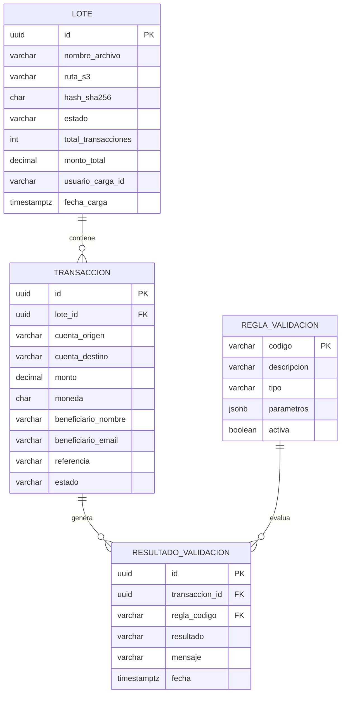
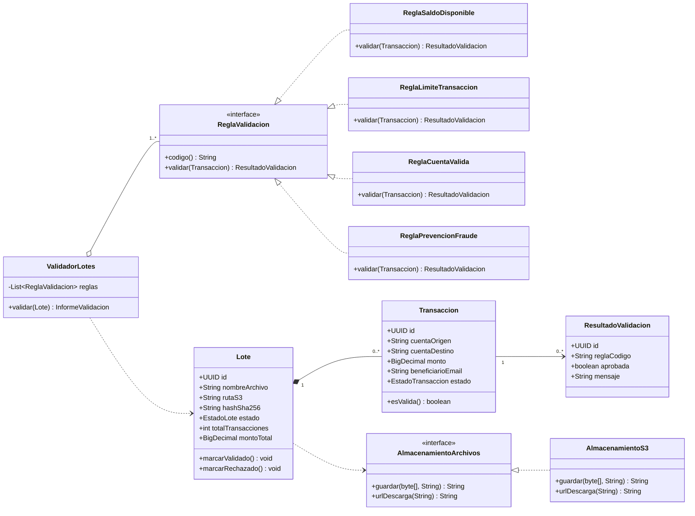
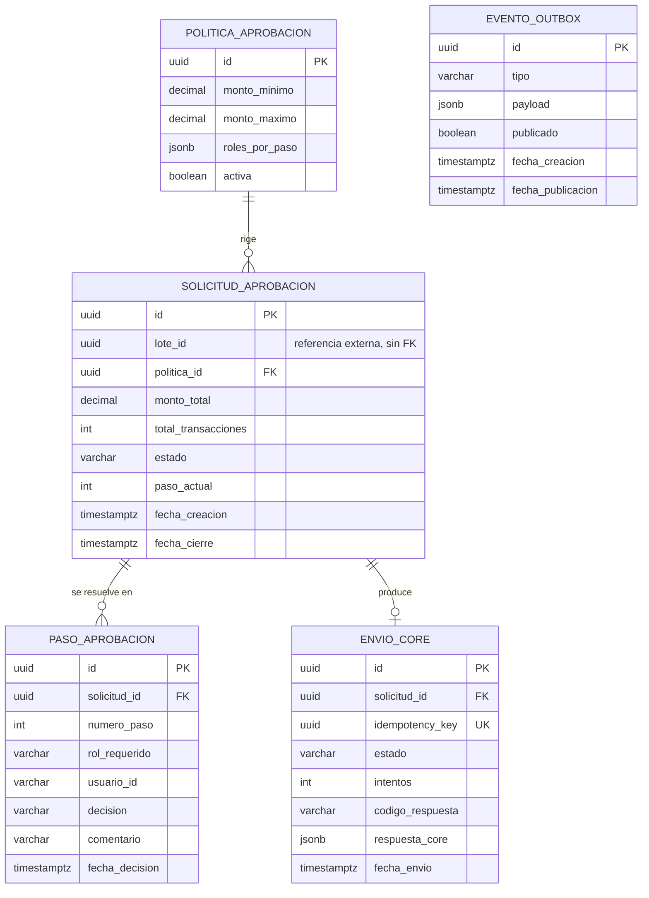
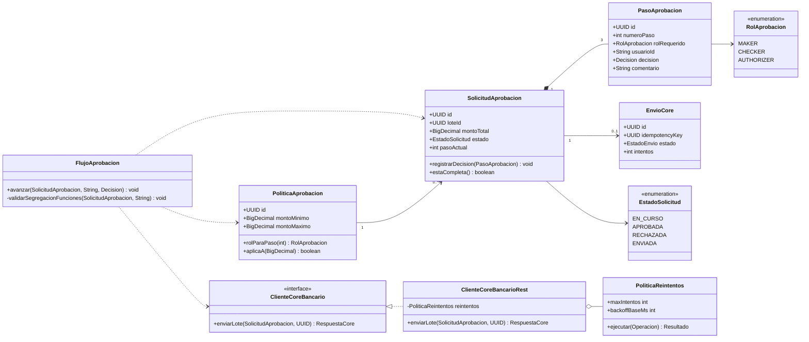
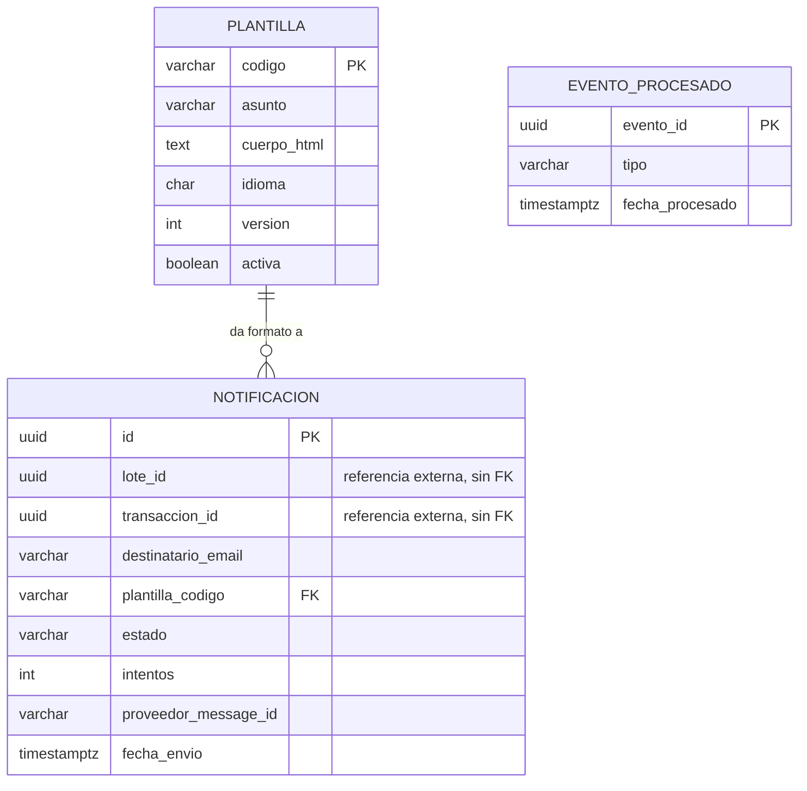
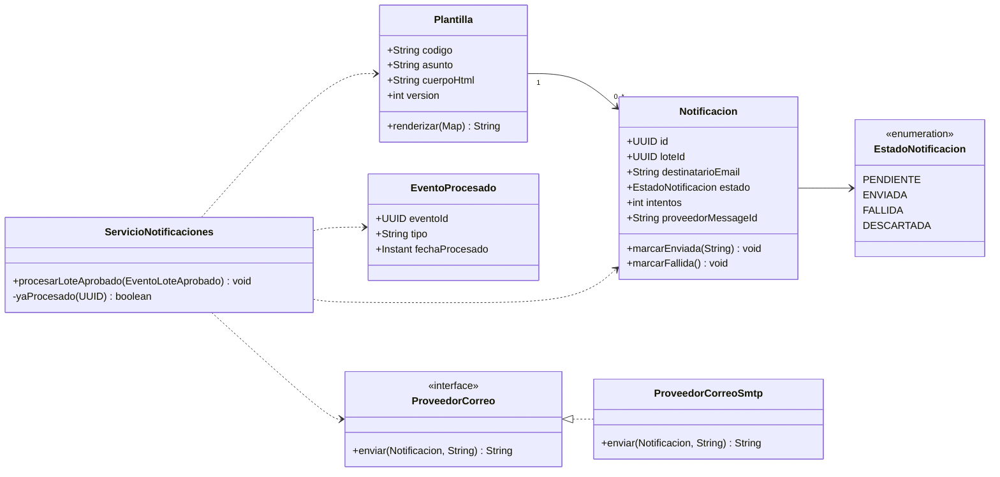

# Modelos de datos y diagramas de clases

Cada microservicio es dueño exclusivo de su base de datos. **Ninguna consulta cruza de un servicio a la base de datos de otro**; la información que un servicio necesita de otro llega por evento o por llamada REST.

Cuando aparece un identificador de otro servicio (por ejemplo `lote_id` en `ms-aprobaciones`) **no se declara como llave foránea**: es una referencia externa. La integridad la garantiza el flujo de eventos, no el motor de base de datos.

---

## 1. `ms-lotes`

### 1.1 Modelo entidad-relación

**Estados del lote:** `CARGADO → VALIDANDO → VALIDADO | RECHAZADO → EN_APROBACION → PROCESADO`

**Por qué `RESULTADO_VALIDACION` es una tabla y no una columna:** una transacción puede fallar varias reglas a la vez. Guardar solo un booleano obligaría al operador a corregir, recargar y descubrir el siguiente error uno por uno. Guardando cada resultado se devuelve el informe completo en una sola pasada.

**Por qué `REGLA_VALIDACION` vive en base de datos:** los límites de transacción y los umbrales de fraude cambian por decisión del negocio, no por despliegue. Con `parametros` en JSONB, ajustar un límite es un `UPDATE`, no una nueva versión del servicio.

### 1.2 Diagrama de clases

**Patrón aplicado — Strategy.** Cada regla de negocio es una implementación de `ReglaValidacion`. Agregar una regla nueva (por ejemplo, lista negra de países) es crear una clase; `ValidadorLotes` no se modifica. Es el principio abierto/cerrado aplicado justo donde el negocio cambia más seguido.

---

## 2. `ms-aprobaciones`

### 2.1 Modelo entidad-relación

**`monto_total` está duplicado respecto a `ms-lotes` a propósito.** La política de aprobación depende del monto. Consultar a `ms-lotes` en cada paso crearía una dependencia síncrona en el camino crítico: si ese servicio cae, nadie podría aprobar nada. Es además un *snapshot* inmutable — el monto aprobado fue el que existía al crear la solicitud.

**`idempotency_key` es única por diseño.** Es lo que permite reintentar el envío al core bancario sin riesgo de duplicar una transferencia. Ante un timeout ambiguo ("¿llegó o no llegó?"), sin esta llave habría que elegir entre no enviar o enviar dos veces; ninguna es aceptable en banca.

**`EVENTO_OUTBOX` no tiene relación con las demás tablas** porque implementa el patrón *Transactional Outbox*: el evento se escribe en la **misma transacción** que actualiza la aprobación. Si el servicio se cae antes de publicar en RabbitMQ, el evento sigue ahí y un proceso aparte lo publica después. Sin esto, un fallo entre "aprobar" y "publicar" perdería la notificación al cliente para siempre.

### 2.2 Diagrama de clases

**`validarSegregacionFunciones` es el corazón de maker-checker-authorizer.** Antes de registrar el paso N verifica que ese `usuario_id` no aparezca en ningún paso anterior de la misma solicitud. Son dos controles distintos y conviene separarlos al explicarlos:

| Pregunta | Quién la responde |
|---|---|
| ¿Este usuario tiene el rol de checker? | Servicio de autorización de la Práctica 2 |
| ¿Es una persona distinta a la del paso anterior? | `ms-aprobaciones`, regla de negocio |

**`PoliticaReintentos` es la misma pieza que ya se implementó en la Práctica 2**, reaplicada aquí para el envío al core bancario.

---

## 3. `ms-notificaciones`

### 3.1 Modelo entidad-relación

**`EVENTO_PROCESADO` implementa el patrón *Inbox* (deduplicación).** RabbitMQ garantiza entrega *al menos una vez*, así que recibir el mismo evento dos veces es un escenario real, no teórico. Antes de procesar, el servicio verifica si ya vio ese `evento_id`. Sin esta tabla, un reintento de la cola enviaría el correo dos veces a cada beneficiario del lote.

**`PLANTILLA` tiene `version`** porque una notificación enviada debe poder reconstruirse tal como se envió. Si alguien edita la plantilla en marzo, el correo de enero no cambia retroactivamente.

### 3.2 Diagrama de clases

**`ProveedorCorreo` es una interfaz y no una clase concreta** porque el proveedor de correo es la pieza con más probabilidad de cambiar (de SMTP propio a SendGrid, SES o Mailgun). Cambiarlo es escribir una implementación nueva, sin tocar `ServicioNotificaciones`.

---

## Resumen de decisiones transversales

| Decisión | Razón |
|---|---|
| Una base de datos por microservicio | Evita acoplamiento invisible: dos servicios sobre la misma tabla ya no se despliegan ni escalan por separado |
| Referencias externas sin llave foránea | Consecuencia directa de lo anterior; la integridad la da el flujo de eventos |
| `monto_total` denormalizado en aprobaciones | Elimina una dependencia síncrona en el camino crítico y fija un *snapshot* inmutable |
| Reglas de validación como Strategy | El negocio cambia sus reglas con frecuencia; agregar una no debe tocar el validador |
| Outbox en aprobaciones | Un fallo entre "aprobar" y "publicar" perdería la notificación al cliente |
| Inbox en notificaciones | La cola entrega *al menos una vez*; sin deduplicar, se enviarían correos repetidos |

**El costo que se acepta, y conviene decirlo antes de que lo señalen:** al no haber una base de datos compartida, se pierden los `JOIN` entre servicios y las transacciones ACID distribuidas. Reconstruir el estado completo de un lote exige consultar dos servicios. Es el precio del desacoplamiento y es una decisión consciente, no un descuido.
