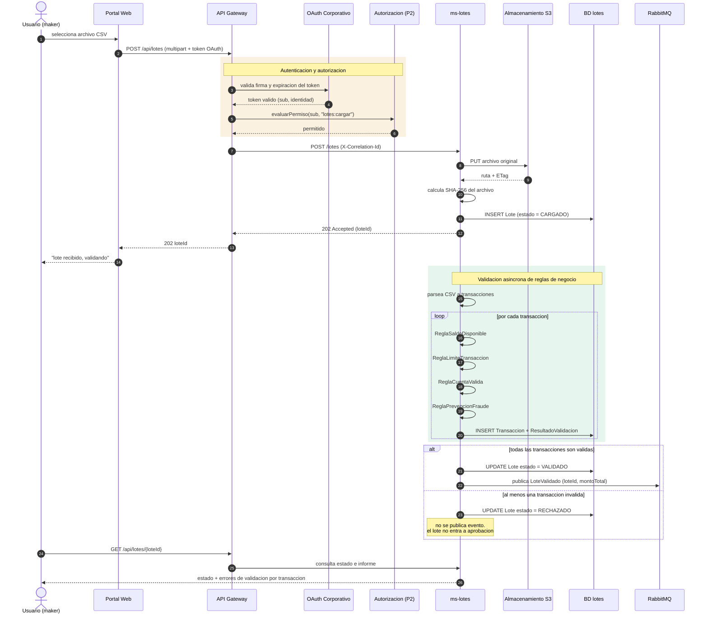
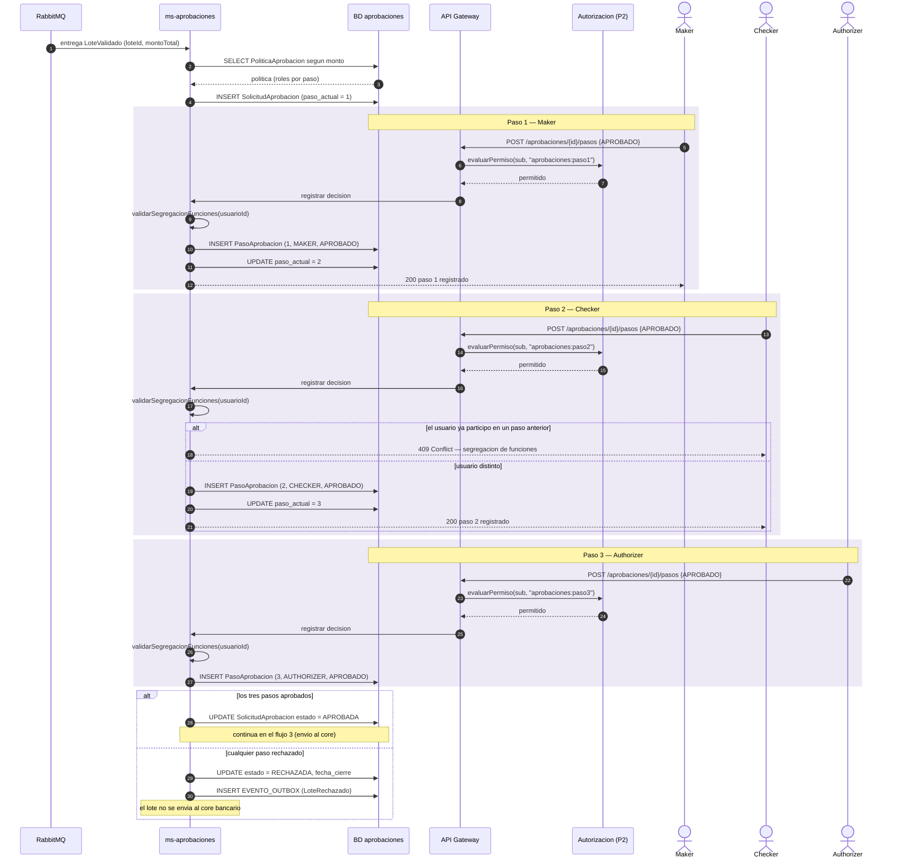
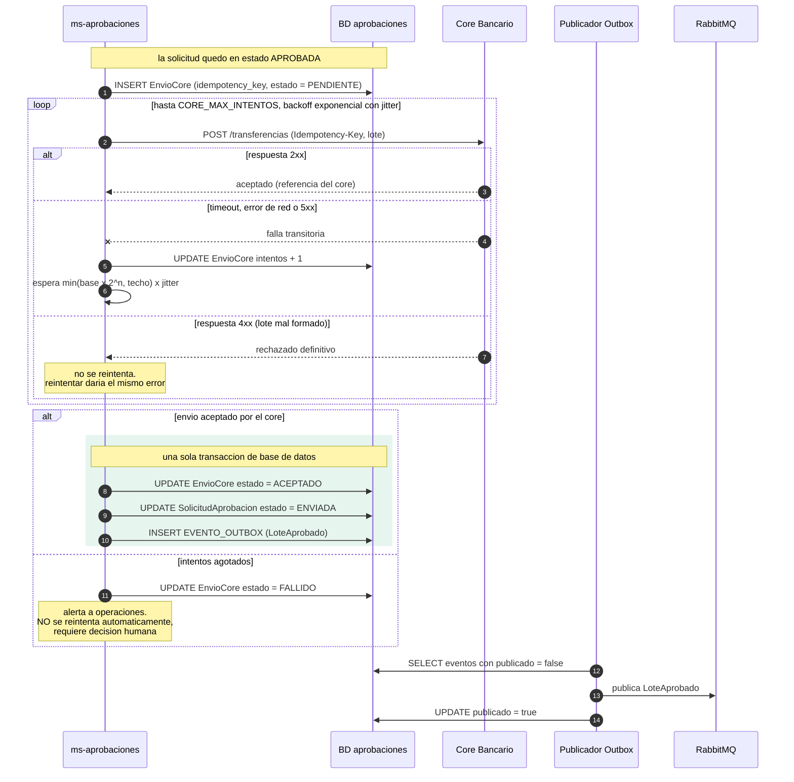
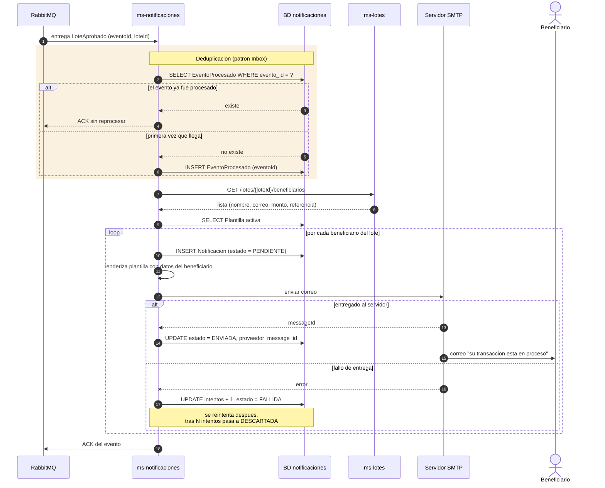

# Diagramas de secuencia — flujos críticos

Cuatro flujos. El enunciado nombra tres explícitamente (aprobación de 3 pasos, envío al core bancario, notificación a clientes); se agrega la **carga y validación del CSV** porque es el punto donde se ve la integración con el módulo de autenticación de la Práctica 2 y donde se aplican las reglas de validación del negocio.

---

## 1. Carga y validación del archivo CSV

Muestra la integración con OAuth corporativo y con el servicio de autorización reutilizado de la Práctica 2.

**Por qué la respuesta es `202 Accepted` y no `200 OK`:** un lote de pago de planillas puede traer miles de filas. Validarlas dentro de la petición HTTP dejaría al usuario esperando y arriesgaría un timeout del navegador. Se acepta el archivo, se responde de inmediato con el `loteId`, y la validación corre aparte. El usuario consulta el resultado después.

**Por qué se calcula el SHA-256:** es la prueba de que el archivo que se descarga más tarde del historial es idéntico al que se cargó. En un sistema bancario auditable, el archivo original es evidencia y no puede alterarse.

**Por qué un lote rechazado no publica evento:** solo los lotes válidos entran al flujo de aprobación. Es lo que impide que una transacción que falló la validación de fraude llegue siquiera a presentarse a un aprobador.

---

## 2. Flujo de aprobación de 3 pasos (maker-checker-authorizer)

**Los dos controles que ocurren en cada paso, y son distintos:**

| Control | Quién lo hace | Qué responde |
|---|---|---|
| `evaluarPermiso` | Servicio de autorización (Práctica 2) | ¿este usuario tiene el rol del paso? |
| `validarSegregacionFunciones` | `ms-aprobaciones` | ¿es una persona distinta a las anteriores? |

El primero es **autorización**; el segundo es **regla de negocio**. Confundirlos es el error típico: si la segregación de funciones viviera en el servicio de permisos, este tendría que conocer el historial de aprobaciones de cada lote, y dejaría de ser un servicio genérico de permisos.

**Por qué `409 Conflict` y no `403 Forbidden`:** el usuario sí tiene el rol (`403` sería mentira). Lo que falla es el estado de la solicitud: ya participó antes. `409` describe exactamente eso — un conflicto con el estado actual del recurso.

**Por qué la política se lee al crear la solicitud y no en cada paso:** para que un cambio de política a mitad del flujo no altere un lote ya en curso. Lo que se aprueba es lo que se pactó al inicio.

---

## 3. Envío al sistema core bancario

**La `Idempotency-Key` es la pieza crítica.** Ante un timeout, el sistema no sabe si el core recibió la transferencia o no. Sin la llave habría que elegir entre no reintentar (y quizá nunca enviar el pago) o reintentar (y quizá duplicar transferencias reales de dinero). Con la llave, el core deduplica: reintentar es seguro.

**Por qué un `4xx` no se reintenta:** un lote mal formado va a fallar igual las cuatro veces. Solo se reintentan fallas *transitorias* — timeout, red caída, `5xx`. Es la misma clasificación que se implementó en la Práctica 2.

**Por qué al agotar los intentos NO se reintenta automáticamente:** en un sistema que mueve dinero, seguir reintentando en segundo plano tras una falla persistente es peligroso. Se marca como `FALLIDO`, se alerta a operaciones y una persona decide. Fallar de forma ruidosa y detenida es preferible a fallar en silencio.

**Por qué los tres `UPDATE`/`INSERT` van en una sola transacción:** es el patrón *Transactional Outbox*. Si el proceso se cayera entre "marcar como enviada" y "publicar el evento", el cliente nunca recibiría su correo. Escribiendo el evento en la misma transacción, el `Publicador Outbox` lo recoge después aunque el servicio se haya reiniciado.

---

## 4. Notificación a los clientes beneficiarios

**Por qué el evento lleva solo el `loteId` y no la lista completa de beneficiarios:** un lote de planilla puede traer miles de registros. Meterlos en el mensaje produciría eventos enormes, lentos de serializar y de propagar. El evento notifica *que algo pasó*; quien lo consume consulta el detalle si lo necesita.

El costo de esa decisión, que conviene reconocer: `ms-notificaciones` queda con una dependencia síncrona hacia `ms-lotes`. Es aceptable porque este flujo ya es asíncrono — nadie está esperando en pantalla. Si `ms-lotes` está caído, el mensaje no se confirma y RabbitMQ lo reintrega después.

**Por qué el `ACK` va al final y no al recibir:** si el servicio se cae a mitad del envío, el evento no fue confirmado y la cola lo vuelve a entregar. La tabla `EventoProcesado` evita entonces que se reenvíen los correos ya despachados.

**Por qué el fallo de un correo no detiene el lote:** que el buzón de un beneficiario esté lleno no debe impedir notificar a los otros 4,999. Cada notificación es independiente y tiene su propio contador de intentos.

---

## Cobertura de las reglas del negocio

| Regla del enunciado | Dónde se resuelve |
|---|---|
| Carga de transacciones vía CSV | Flujo 1 |
| Validación por reglas internas (saldo, límites, cuentas, fraude) | Flujo 1, bloque de validación asíncrona |
| Almacenamiento del archivo en la nube | Flujo 1, `PUT` a S3 |
| Autenticación OAuth + módulo de la Práctica 2 | Flujo 1 (bloque ámbar) y en cada paso del flujo 2 |
| Aprobación de 3 pasos por usuarios distintos | Flujo 2, con `validarSegregacionFunciones` |
| Envío al core bancario tras la aprobación | Flujo 3 |
| Correo a todos los beneficiarios del lote | Flujo 4 |
| Historial consultable con descarga | Flujo 1, consulta final; `hash_sha256` garantiza integridad |
| Logging centralizado y auditable | `X-Correlation-Id` propagado desde el flujo 1; el rastro de auditoría vive en `PasoAprobacion` |
