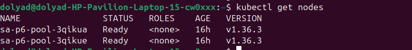
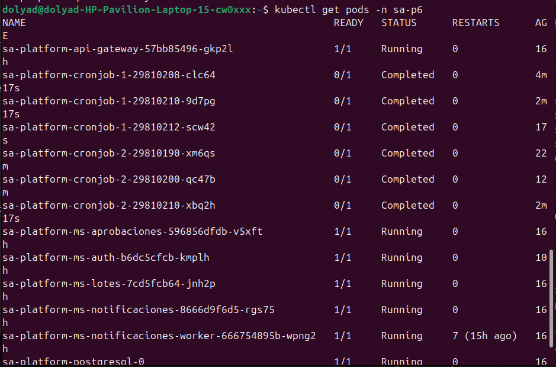
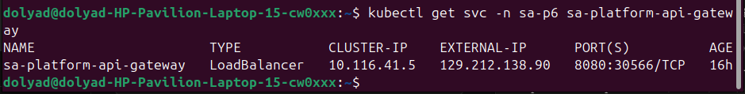
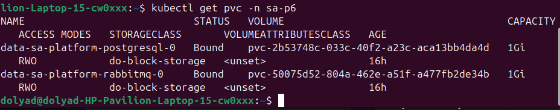

# Práctica 6 — Despliegue de la plataforma en un clúster de Kubernetes en la nube

**Universidad de San Carlos de Guatemala — Facultad de Ingeniería**
**Ingeniería en Ciencias y Sistemas — Software Avanzado — Segundo Semestre 2026**

**Estudiante:** Daniel Eduardo Velásquez Avila
**Carné:** 202200041
**Proveedor de nube:** DigitalOcean (DOKS)

---

## 1. Resumen del despliegue

La plataforma de microservicios construida en la Práctica 5 (`sa-platform`, un
chart de Helm con 5 microservicios propios, 2 cronjobs, PostgreSQL y RabbitMQ)
se desplegó en un clúster de Kubernetes administrado por DigitalOcean
(DOKS), con las imágenes publicadas en un registro privado propio y el
sistema expuesto públicamente mediante un Service de tipo `LoadBalancer`.

| Dato                     | Valor                                                           |
| ------------------------ | --------------------------------------------------------------- |
| Proveedor                | DigitalOcean                                                    |
| Servicio                 | DOKS (DigitalOcean Kubernetes)                                  |
| Nombre del clúster       | `sa-p6-cluster`                                                 |
| Región                   | `nyc1`                                                          |
| Nodos                    | 2 × `s-1vcpu-2gb`                                               |
| Registro de contenedores | DOCR (`registry.digitalocean.com/sa-p6-202200041`), **privado** |
| Namespace                | `sa-p6`                                                         |
| Dirección pública        | `129.212.138.90:8080`                                           |

---

## 2. Procedimiento de despliegue

### 2.1 Prerrequisitos

- Cuenta de DigitalOcean con método de pago verificado.
- `doctl` instalado y autenticado (`doctl auth init`).
- `kubectl` y `helm` instalados localmente.
- Proyecto de la Práctica 5 (imágenes Docker, chart de Helm) funcionando
  localmente en minikube antes de migrar.

### 2.2 Creación del registro de contenedores

```bash
doctl registry create sa-p6-202200041
doctl registry login
```

El plan **Starter** (gratuito, 500 MiB) es suficiente si las imágenes se
consolidan en pocos repositorios. Se optó por **2 repositorios** en vez de 7
(uno por componente) porque el plan gratuito/Basic limita el número de
repositorios, no el número de tags dentro de cada uno:

- `microservicios` — tags: `api-gateway-1.0.0`, `ms-auth-1.0.1`,
  `ms-lotes-1.0.0`, `ms-aprobaciones-1.0.0`, `ms-notificaciones-1.0.0`
- `cronjobs` — tags: `registro-1.0.0`, `resumen-1.0.0`

### 2.3 Publicación de las imágenes

```bash
REGISTRY="registry.digitalocean.com/sa-p6-202200041"

docker build -t sa-p5/api-gateway:1.0.0     services/api-gateway
docker build -t sa-p5/ms-auth:1.0.1         services/ms-auth
docker build -t sa-p5/ms-lotes:1.0.0        services/ms-lotes
docker build -t sa-p5/ms-aprobaciones:1.0.0 services/ms-aprobaciones
docker build -t sa-p5/ms-notificaciones:1.0.0 services/ms-notificaciones
docker build -t sa-p5/cronjob-registro:1.0.0  scripts/cronjob-1
docker build -t sa-p5/cronjob-resumen:1.0.0   scripts/cronjob-2

docker tag sa-p5/api-gateway:1.0.0        $REGISTRY/microservicios:api-gateway-1.0.0
docker tag sa-p5/ms-auth:1.0.1            $REGISTRY/microservicios:ms-auth-1.0.1
docker tag sa-p5/ms-lotes:1.0.0           $REGISTRY/microservicios:ms-lotes-1.0.0
docker tag sa-p5/ms-aprobaciones:1.0.0    $REGISTRY/microservicios:ms-aprobaciones-1.0.0
docker tag sa-p5/ms-notificaciones:1.0.0  $REGISTRY/microservicios:ms-notificaciones-1.0.0
docker tag sa-p5/cronjob-registro:1.0.0   $REGISTRY/cronjobs:registro-1.0.0
docker tag sa-p5/cronjob-resumen:1.0.0    $REGISTRY/cronjobs:resumen-1.0.0

docker push $REGISTRY/microservicios:api-gateway-1.0.0
docker push $REGISTRY/microservicios:ms-auth-1.0.1
docker push $REGISTRY/microservicios:ms-lotes-1.0.0
docker push $REGISTRY/microservicios:ms-aprobaciones-1.0.0
docker push $REGISTRY/microservicios:ms-notificaciones-1.0.0
docker push $REGISTRY/cronjobs:registro-1.0.0
docker push $REGISTRY/cronjobs:resumen-1.0.0
```

### 2.4 Creación del clúster

```bash
doctl kubernetes cluster create sa-p6-cluster \
  --region nyc1 \
  --node-pool "name=sa-p6-pool;size=s-1vcpu-2gb;count=2" \
  --wait

doctl kubernetes cluster kubeconfig save sa-p6-cluster
```

### 2.5 Integración del registro privado con el clúster

```bash
doctl kubernetes cluster registry add sa-p6-cluster
# Después de que exista el namespace (ver 2.6):
doctl registry kubernetes-manifest --namespace sa-p6 | kubectl apply -f -

for sa in $(kubectl get sa -n sa-p6 -o name); do
  kubectl patch $sa -n sa-p6 \
    -p '{"imagePullSecrets": [{"name": "registry-sa-p6-202200041"}]}'
done
```

### 2.6 Despliegue con Helm

```bash
helm upgrade --install sa-platform ./charts/sa-platform \
  --namespace sa-p6 \
  --create-namespace \
  -f charts/sa-platform/values.yaml \
  -f charts/sa-platform/values-do.yaml \
  -f secretos.yaml \
  --set-file secrets.jwtPrivateKey=keys/jwt_private.pem \
  --set-file secrets.jwtPublicKey=keys/jwt_public.pem \
  --timeout 10m
```

`values-do.yaml` es un archivo de valores adicional, específico para este
proveedor, que se aplica **encima** de `values.yaml` sin modificarlo (ver
sección 3, "Adaptaciones al chart").

### 2.7 Verificación

```bash
kubectl get pods -n sa-p6
kubectl get svc -n sa-p6 sa-platform-api-gateway
kubectl get pvc -n sa-p6
```

---

## 3. Adaptaciones al chart para el entorno de nube

El chart de la Práctica 5 fue diseñado para minikube. Migrarlo a un clúster
administrado requirió los siguientes cambios, aplicados mediante un archivo
`values-do.yaml` adicional (no se modificó `values.yaml` ni `values-dev.yaml`,
que siguen sirviendo para el entorno local):

| #   | Adaptación                                                                    | Motivo                                                                                                                                                                                                                        |
| --- | ----------------------------------------------------------------------------- | ----------------------------------------------------------------------------------------------------------------------------------------------------------------------------------------------------------------------------- |
| 1   | `service.type: LoadBalancer` en el api-gateway (antes `ClusterIP` fijo)       | DOKS no trae un Ingress Controller por defecto; el LoadBalancer es la vía de entrada pública.                                                                                                                                 |
| 2   | `ingress.enabled: false`                                                      | El `className: nginx` original no existe en DOKS sin instalarlo aparte.                                                                                                                                                       |
| 3   | `storageClass: do-block-storage` en PostgreSQL y RabbitMQ                     | La StorageClass de minikube no aplica; cada proveedor expone la suya propia.                                                                                                                                                  |
| 4   | `bitnamilegacy/postgresql` y `bitnamilegacy/rabbitmq` con tags fijos          | Bitnami retiró su catálogo público (`docker.io/bitnami`); las imágenes existentes se movieron a un repositorio "legacy" sin actualizaciones futuras.                                                                          |
| 5   | `global.security.allowInsecureImages: true`                                   | Los charts de Bitnami validan el origen de sus imágenes contra un catálogo oficial; `bitnamilegacy` no está en esa lista aunque sea la única alternativa funcional tras el retiro.                                            |
| 6   | `global.hpa.minReplicas: 1` (antes 2) y `replicas: 1` por microservicio       | 2 nodos `s-1vcpu-2gb` no tienen CPU/memoria suficiente para 2 réplicas × 5 servicios + PostgreSQL + RabbitMQ simultáneamente. El enunciado exige mínimo 2 **nodos**, no 2 réplicas por servicio.                              |
| 7   | NetworkPolicy del api-gateway: origen configurable (`permitirEntradaPublica`) | La política original solo aceptaba tráfico desde el namespace `ingress-nginx`, inexistente en DOKS. Sin este cambio, el tráfico del LoadBalancer llegaba al pod y era descartado en silencio (timeout, no rechazo explícito). |
| 8   | `resourceQuota` ajustada (CPU/memoria al alza)                                | Los nodos de DOKS tienen menos capacidad que el entorno local; la cuota original bloqueaba el rollout.                                                                                                                        |

Un bug adicional, **no relacionado con la nube en sí**, se descubrió durante
el despliegue: el `entrypoint.sh` de `ms-auth` tenía una espera a PostgreSQL
que no esperaba nada real (verificaba que el paquete `pg` se pudiera
importar, no que la base aceptara conexiones), y silenciaba cualquier fallo
del script de siembra de datos (`|| echo "seed omitido"`). En minikube nunca
se manifestó porque PostgreSQL ya llevaba tiempo arriba de sesiones previas;
en un clúster que arranca todo en frío, la condición de carrera se hizo real
y el servidor arrancaba sin tablas ni usuarios. Se corrigió con una espera
real (reintentos de una consulta genuina) y quitando el `|| echo` para que
el contenedor falle de verdad si el sembrado no puede completarse.

---

## 4. Evidencia de funcionamiento

### 4.1 Clúster y nodos

```
$ kubectl get nodes
NAME                STATUS   ROLES    AGE   VERSION
sa-p6-pool-xxxxxx    Ready    <none>   Xh    v1.36.3-do.3
sa-p6-pool-yyyyyy    Ready    <none>   Xh    v1.36.3-do.3
```



### 4.2 Pods desplegados



### 4.3 Exposición pública



### 4.4 Petición desde internet

```
$ curl -i http://129.212.138.90:8080/health
HTTP/1.1 200 OK
{"servicio":"api-gateway","estado":"ok","destinos":{...}}
```

### 4.5 Flujo completo verificado desde fuera del clúster

| Prueba                                                        | Resultado                |
| ------------------------------------------------------------- | ------------------------ |
| Login (`POST /api/auth/login`)                                | `200`, token JWT emitido |
| Ruta protegida sin token                                      | `401 Unauthorized`       |
| Ruta protegida con token                                      | `200 OK`                 |
| Ruta exclusiva de admin, con token de cliente                 | `403 Forbidden`          |
| Creación de lote (`POST /api/lotes`)                          | `201 Created`            |
| Consulta GraphQL de lotes                                     | `200`, datos correctos   |
| Flujo de aprobación de 3 pasos (maker → checker → authorizer) | `estado: APROBADA`       |

### 4.6 Comunicación asíncrona (requisito obligatorio)

Al completar el tercer paso de aprobación, el evento se publicó en RabbitMQ
y fue consumido por el worker de notificaciones en el mismo segundo:

```
$ curl ... /api/aprobaciones/2/pasos ...
{"id":2,...,"estado":"APROBADA",...}
Date: Sat, 05 Sep 2026 03:53:16 GMT

$ kubectl logs -n sa-p6 deploy/sa-platform-ms-notificaciones-worker --tail=5
2026-09-04 21:53:16,752 INFO [worker] notificacion registrada para el lote 2
```

Los cronjobs, que dependen de la misma base de datos, también se ejecutan
correctamente cada 2 y 10 minutos respectivamente (`Completed`, sin errores).

### 4.7 Almacenamiento persistente



---

## 5. Costo aproximado

| Recurso                                 | Precio unitario             | Costo/hora aprox. |
| --------------------------------------- | --------------------------- | ----------------- |
| Plano de control DOKS                   | $0 (DOKS no cobra por esto) | $0.000            |
| 2 × Droplet `s-1vcpu-2gb`               | $12.00/mes c/u              | $0.033            |
| Load Balancer                           | $12.00/mes                  | $0.016            |
| Block Storage (2 × 1 GiB)               | $0.10/GiB/mes               | $0.0003           |
| Container Registry (plan Starter/Basic) | $0 / $5 mes                 | —                 |
| **Total combinado**                     |                             | **≈ $0.05/hora**  |

**Tiempo real del clúster activo:** desde `[HH:MM]` del `[fecha]` hasta
`[HH:MM]` del `[fecha]` → aproximadamente `[N]` horas.

**Costo total estimado:** `[N] horas × $0.05 ≈ $[monto]`, cubierto en su
totalidad por el crédito de bienvenida de $5 otorgado al registrar la cuenta.

---

## 6. Procedimiento de eliminación de recursos

Orden crítico: primero la aplicación (libera LoadBalancer y volúmenes),
después el clúster. Invertir el orden puede dejar recursos huérfanos
cobrando fuera de Kubernetes.

```bash
# 1. Desinstalar la aplicación
helm uninstall sa-platform -n sa-p6

# 2. Confirmar que el Load Balancer se liberó
doctl compute load-balancer list

# 3. Confirmar que los volúmenes se liberaron
doctl compute volume list

# 4. Eliminar el clúster
doctl kubernetes cluster delete sa-p6-cluster --force

# 5. Verificar que no queda nada activo
doctl kubernetes cluster list
doctl compute droplet list
```

El registro de contenedores se conservó / eliminó con:

```bash
doctl registry delete --force
```

---

**Administrados por DigitalOcean:**

- El plano de control (API server, etcd, scheduler, controller manager) y
  su alta disponibilidad.
- El aprovisionamiento y mantenimiento del sistema operativo de los nodos.
- El CNI (Cilium) y su instalación base.
- El aprovisionamiento físico de los Load Balancers y los volúmenes de
  bloque cuando se solicitan desde Kubernetes.
- Los parches de seguridad del plano de control.

**Responsabilidad del estudiante:**

- El diseño y la corrección de los manifiestos de Kubernetes (Deployments,
  Services, ConfigMaps, Secrets, NetworkPolicies, HPA).
- El dimensionamiento de recursos (`requests`/`limits`) acorde a la
  capacidad real de los nodos contratados.
- La gestión del ciclo de vida de las credenciales (llaves JWT, contraseñas
  de base de datos) y su almacenamiento seguro mediante Secrets.
- La corrección del comportamiento de la aplicación ante condiciones reales
  de un entorno distribuido (reintentos de conexión, tolerancia a fallos
  temporales de red o de dependencias).
- La configuración explícita de las políticas de red: aunque el CNI las
  hace cumplir, el contenido y la corrección de esas políticas son
  enteramente responsabilidad de quien escribe el chart.
- El control de costos: elegir el tamaño y la cantidad de nodos, la región,
  y eliminar los recursos cuando no se usan.

### 7.5 ¿Qué costos genera el despliegue realizado y cómo podrían reducirse?

El despliegue generó un costo aproximado de $0.05 por hora, compuesto por
dos droplets `s-1vcpu-2gb` (~$0.033/hora combinados), un Load Balancer
(~$0.016/hora) y un volumen de bloque marginal (~$0.0003/hora); el plano de
control de DOKS no tiene costo. El total de la práctica, con el clúster
activo durante aproximadamente `[N]` horas, ascendió a cerca de
`$[monto]`, cubierto por completo por el crédito de bienvenida de $5
otorgado al crear la cuenta.

Formas concretas de reducir este costo, de haber sido necesario sostenerlo
por más tiempo:

- **Eliminar el clúster entre sesiones de trabajo**, en vez de dejarlo
  corriendo mientras no se usa activamente — es la medida de mayor impacto,
  ya que el costo es por hora de existencia, no por uso.
- **Usar el tamaño de nodo más pequeño disponible** que aún soporte la
  carga (`s-1vcpu-2gb`), en vez de sobre-aprovisionar.
- **Reducir las réplicas al mínimo necesario** por servicio (se ajustó de
  2 a 1 réplica por microservicio), dado que el enunciado exige un mínimo
  de nodos, no de réplicas de aplicación.
- **Evitar clústeres regionales** cuando un clúster zonal es suficiente,
  ya que solo los zonales (o Autopilot, en otros proveedores) suelen
  calificar para créditos de nivel gratuito del plano de control.
- **Consolidar imágenes en pocos repositorios** de registro para
  mantenerse en el plan gratuito o más económico del registro de
  contenedores, en vez de pagar un plan superior únicamente por exceder el
  número de repositorios permitidos.
