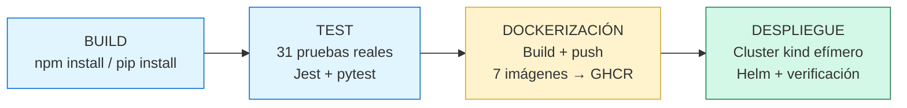
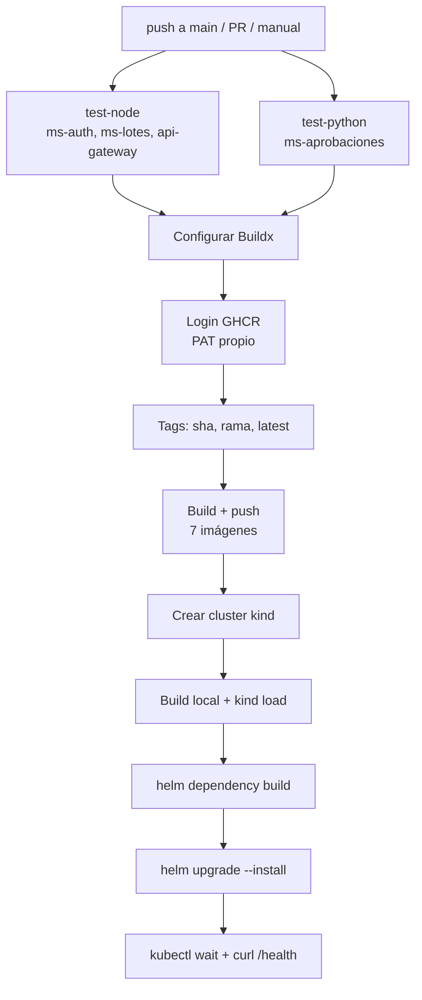

# Práctica 7 — Documentación técnica

## Resumen

Pipeline de CI/CD en GitHub Actions para la plataforma de microservicios
(Prácticas 5-6), con 4 etapas automatizadas: build, test, dockerización y
despliegue. El despliegue se demuestra en un clúster **kind** efímero,
creado y destruido dentro del propio runner de GitHub Actions — ("puede ser
local... emular un kind"), dado que la práctica no exige nube real.

## Diagrama del flujo

## Los 4 jobs, en detalle

| Job | Qué hace |
|---|---|
| `test-node` | Matriz sobre `ms-auth`, `ms-lotes`, `api-gateway`. `npm install` + `npm test` |
| `test-python` | `ms-aprobaciones`. `pip install -r requirements-dev.txt` + `python -m pytest` |
| `build-and-push` | Solo corre si los tests pasan (`needs`). Construye y publica 7 imágenes en GHCR, con 3 tags cada una (SHA del commit, rama, `latest`) |
| `deploy-kind` | Crea el clúster, carga las imágenes localmente (`kind load docker-image`, sin pasar por GHCR), instala con Helm, verifica pods y `/health` |

## 31 pruebas unitarias reales

No placeholders — pruebas contra lógica de negocio genuina:

- **`ms-auth` (7)**: validación de registro (rechaza escalación de privilegios vía campo `rol`), formato de correo, longitud de nombre, login.
- **`ms-lotes` (10)**: reglas de transacciones (cuentas iguales, montos negativos/cero/excesivos, límite de 50000, correo de beneficiario).
- **`ms-aprobaciones` (5)**: máquina de estados de 3 pasos (decisión inválida, solicitud inexistente/cerrada, segregación de funciones), con la conexión a BD simulada (técnica estándar, no bypass).
- **`api-gateway` (9)**: middleware de autenticación, incluyendo la prueba más crítica — un token firmado con una llave **distinta** es rechazado correctamente.

## Bugs reales encontrados y resueltos durante la construcción

| # | Síntoma | Causa raíz | Fix |
|---|---|---|---|
| 1 | `ModuleNotFoundError: No module named 'app'` en CI | `pytest` sin `-m` no agrega el directorio actual al `sys.path` | Cambiar a `python -m pytest` |
| 2 | `Cache export is not supported for the docker driver` | Faltaba `docker/setup-buildx-action` antes del build | Agregar el paso de Buildx |
| 3 | `403 Forbidden` al hacer push a GHCR | El `GITHUB_TOKEN` automático no tenía permisos suficientes | Usar un Personal Access Token propio (`GHCR_TOKEN`) como secret |
| 4 | `namespaces "sa-p7" already exists` / luego `not found` | Conflicto entre `--create-namespace` de Helm y el `namespace.yaml` propio del chart | Quitar `--create-namespace`, dejar que el chart cree el namespace por sí solo |
| 5 | `kubectl wait` fallaba con todo sano | `--all` incluía pods de CronJob ya `Completed`, que nunca alcanzan `Ready` | Filtrar por `--field-selector=status.phase=Running` |

## Versionamiento

Cada imagen se publica con 3 tags: el hash corto del commit (trazabilidad
exacta), el nombre de la rama, y `latest` solo en `main`. Nunca se usa
`latest` como única referencia para el despliegue.

## Decisión de arquitectura: `kind` en vez de nube real

Documentado explícitamente porque se desvía del enunciado original de P6:
el auxiliar autorizó esta simplificación en el foro del curso, dado que el
objetivo de la P7 es demostrar el mecanismo de CI/CD, no la infraestructura
de nube en sí. El clúster vive solo durante la ejecución del job y se
destruye automáticamente al finalizar — sin costo, sin credenciales de
proveedor externo.
