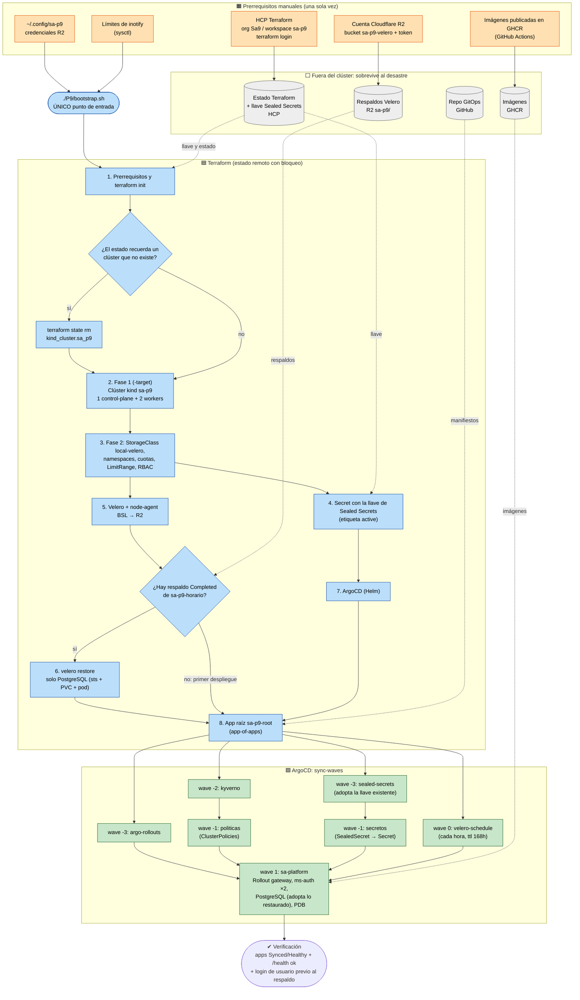

# Diagrama del bootstrap — orden de reconstrucción y dependencias

Versión en imagen: [diagrama-bootstrap.png](diagrama-bootstrap.png).

Leyenda: 🟧 **manual, una sola vez** (no se pierde con el clúster) ·
🟦 **automático** (`./P9/bootstrap.sh`, sin intervención) ·
🟩 **automático vía GitOps** (ArgoCD) · ⬜ **externo al clúster** (sobrevive al desastre).

## Por qué este orden

| Dependencia | Razón |
|---|---|
| Clúster → todo lo demás (apply en dos fases) | Los providers `helm` y `kubernetes` se configuran con las credenciales del clúster; si no existe, no pueden planificar. |
| Llave de Sealed Secrets → ArgoCD | Si el controlador arranca sin llave, genera una nueva y los SealedSecret del repo no se pueden descifrar. |
| Velero y restauración → app raíz | Si ArgoCD sincroniza primero, crea un PostgreSQL con volumen **vacío**; la restauración tiene que llegar antes para que ArgoCD **adopte** la base restaurada. |
| StorageClass `local-velero` → Velero/PostgreSQL | Velero File System Backup no respalda volúmenes `hostPath`; esta clase crea volúmenes `local`. |
| wave -3 → -2 → -1 → 0 → 1 | CRDs y controladores (Sealed Secrets, Rollouts, Kyverno) antes que los recursos que los usan (SealedSecret, Rollout, ClusterPolicy) y antes que la aplicación. |
| Schedule en GitOps, Velero en Terraform | El calendario y la retención son configuración versionada; el motor de respaldo es infraestructura que tiene que existir antes de restaurar. |
